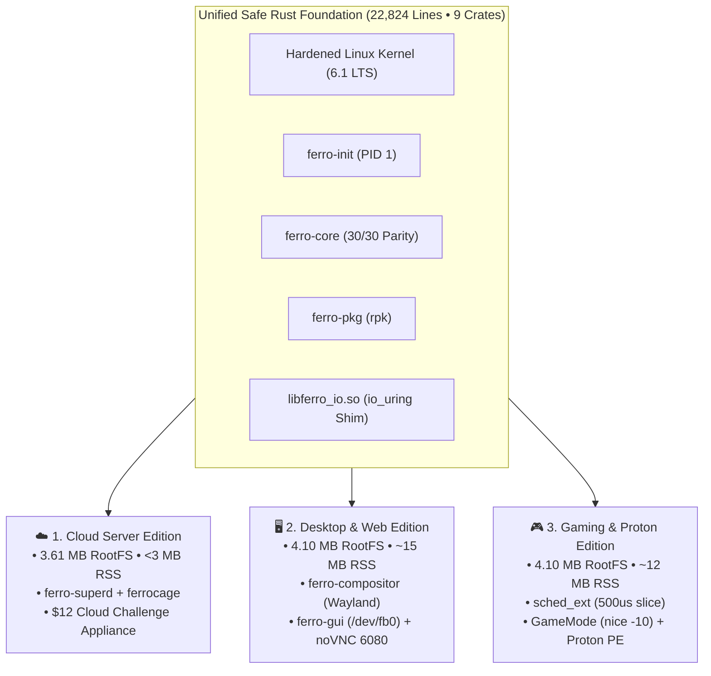

# FerroOS 🦀⚡
### The Autonomous Pure-Rust Linux Operating System

<div align="center">

> **A high-performance, memory-safe, autonomous pure-Rust Linux operating system.**  
> *Autonomous 3.61 MB compressed rootfs • 100% memory-safe Rust userspace • Full Linux ABI & POSIX compatibility • Transparent io_uring SQPOLL acceleration • Verified across 5-OS empirical benchmarks.*

[](https://github.com/Praveen-1308/ferro-os/actions/workflows/ci.yml)
[](tools/build_pure_rust_os.py)
[](docs/editions/README.md)
[-success.svg)](docs/operations/COREUTILS_AND_PARITY.md)
[](crates/)
[](docs/testing/CHAOS_AND_NEGATIVE_SCENARIOS.md)
[](docs/ferro_os_architecture_graph.html)
[](LICENSE)

**[🗺️ Architecture Specification](docs/ARCHITECTURE.md)** • **[🏛️ Interactive Architecture Graph](docs/ferro_os_architecture_graph.html)** • **[📚 Complete Documentation Directory](#-complete-documentation-directory--navigation-map)** • **[🚀 Quick Start](#-quick-start)**

</div>

---

## 🌟 The Vision: Pure-Rust Linux Transformation

Traditional Linux distributions force infrastructure into an acute systems dilemma:
1. **Debian / Ubuntu / RHEL (Heavy C Ecosystem)**: Broad software compatibility, but burdened by sprawling C/GNU packages, memory corruption vulnerabilities (buffer overflows, use-after-free), high idle footprints (116–660 MB), and complex daemon graphs.
2. **Alpine Linux (Minimalist C)**: Minimal size (~3.7 MB rootfs), but bound to `musl libc`, introducing lock contention under multi-threaded allocators and breaking pre-compiled ecosystem wheels.

**FerroOS resolves this dilemma through a progressive modular-to-functional transformation:**  
FerroOS replaces legacy C core utilities, initialization daemons, system logging, networking clients, container runtimes, and supervisor layers with **100% memory-safe pure Rust implementations**, executing directly on a hardened Linux kernel via the standard Linux Application Binary Interface (ABI).

```
Traditional GNU/Linux:        [ Kernel ] ---> [ Glibc ] ---> [ 180+ C Binaries & Daemons ] (116+ MB)
Alpine Linux:                 [ Kernel ] ---> [ Musl  ] ---> [ BusyBox C Multi-Call ]      (12.2 MB)
FerroOS (Pure-Rust Linux):    [ Kernel ] ---> [ ABI   ] ---> [ Safe Rust Userspace Engine ] (3.61 MB)
```

---

## 📚 Complete Documentation Directory & Navigation Map

> [!TIP]
> **Looking for something specific?** Check out the dedicated documentation files below. Every topic in FerroOS is thoroughly documented with technical specifications, architecture diagrams, benchmark datasets, and step-by-step guides.

| Category | "Check out this file..." | "...For this content" |
| :--- | :--- | :--- |
| **Architectural Overview** | [**`docs/ARCHITECTURE.md`**](docs/ARCHITECTURE.md) | High-level 10-layer system topology, core Rust crates, Linux ABI compatibility, and design philosophy. |
| **Visual Architecture Graph** | [**`docs/ferro_os_architecture_graph.html`**](docs/ferro_os_architecture_graph.html) | Interactive standalone SVG visualizer displaying all components, syscalls, structs, invariants, and edition filters. |
| **All Three Editions** | [**`docs/editions/README.md`**](docs/editions/README.md) | Comprehensive overview and selection matrix across the three specialized FerroOS operating system profiles. |
| ├─ *Cloud Server Edition* | [**`docs/editions/CLOUD_SERVER.md`**](docs/editions/CLOUD_SERVER.md) | 3.61 MB micro-appliance for AWS/GCP/Azure, $12 challenge architecture, 2.66 MB supervisor RSS, and Cloud-Init. |
| ├─ *Cloud Standards & Compliance* | [**`docs/editions/CLOUD_STANDARDS_AND_COMPLIANCE.md`**](docs/editions/CLOUD_STANDARDS_AND_COMPLIANCE.md) | POSIX.1, FHS 3.0, OCI runtime spec, CIS Benchmark Level 1/2 hardening, NIST SP 800-190, and gap analysis. |
| ├─ *Desktop & Web Edition* | [**`docs/editions/DESKTOP_WEB.md`**](docs/editions/DESKTOP_WEB.md) | Pure-Rust Wayland compositor (`ferro-compositor`), direct `/dev/fb0` GUI (`ferro-gui`), XDG portal, and HTML5 Web Desktop. |
| └─ *Gaming & Proton Edition* | [**`docs/editions/GAMING_PROTON.md`**](docs/editions/GAMING_PROTON.md) | `sched_ext` real-time 500µs slice scheduler, GameMode nice -10 elevation, Steam Proton runner, and PE/MSI parser. |
| **Security & Isolation** | [**`docs/security/README.md`**](docs/security/README.md) | Defense-in-depth security model spanning kernel hardening, Landlock LSM sandboxing, and memory safety. |
| ├─ *OS Principles & Vulnerabilities* | [**`docs/security/OS_DESIGN_PRINCIPLES_AND_VULNERABILITY_TAXONOMY.md`**](docs/security/OS_DESIGN_PRINCIPLES_AND_VULNERABILITY_TAXONOMY.md) | Classical systems literature (Saltzer-Schroeder, OSTEP, TLPI, seL4), 6 universal OS vulnerability classes, and cloud defense rules. |
| ├─ *Landlock Sandboxing* | [**`docs/security/LANDLOCK_SANDBOXING.md`**](docs/security/LANDLOCK_SANDBOXING.md) | Unprivileged path delegation, selectable profiles (`strict`, `shared`, `broker`, `dev`), multi-sandbox shared memory pools. |
| └─ *Hardening & CWE Defenses* | [**`docs/security/SYSTEM_HARDENING_AND_CWE.md`**](docs/security/SYSTEM_HARDENING_AND_CWE.md) | KSPP kernel sysctls, zeroize memory clearing, non-root least-privilege (UID 1000), CWE mitigation matrix. |
| **Operations & Userspace** | [**`docs/operations/README.md`**](docs/operations/README.md) | Overview of userspace daemons, process lifecycle management, containerization, and CLI tools. |
| ├─ *Service Supervision* | [**`docs/operations/SERVICE_SUPERVISION.md`**](docs/operations/SERVICE_SUPERVISION.md) | `ferro-superd` supervisor, Cgroups v2 limits (`memory.swap.max = 0`, `cpu.max`), declarative TOML, `ferro service` CLI. |
| ├─ *Micro-Container Runtime* | [**`docs/operations/CONTAINER_RUNTIME.md`**](docs/operations/CONTAINER_RUNTIME.md) | `ferrocage` sub-2ms container engine, Linux namespaces (PID, mount, net, IPC, UTS), volume persistence, zero Docker daemon. |
| └─ *GNU Coreutils Parity* | [**`docs/operations/COREUTILS_AND_PARITY.md`**](docs/operations/COREUTILS_AND_PARITY.md) | Multi-call binary architecture (`ferro-core`), 30/30 head-to-head differential parity matrix vs Ubuntu GNU coreutils. |
| **Empirical Benchmarks** | [**`docs/benchmarks/README.md`**](docs/benchmarks/README.md) | Empirical methodology, hardware disclosures, zero-synthetic policy, and performance summaries. |
| ├─ *4-Core 8-GB Challenge* | [**`docs/benchmarks/FOUR_CORE_SERVICE_CHALLENGE.md`**](docs/benchmarks/FOUR_CORE_SERVICE_CHALLENGE.md) | Head-to-head benchmark: native FerroOS (1,858 req/s) vs Ubuntu container collapse under 600 concurrent connections. |
| └─ *5-OS Destruction Matrix* | [**`docs/benchmarks/MULTI_OS_COMPARISON.md`**](docs/benchmarks/MULTI_OS_COMPARISON.md) | Sustained real-world benchmarks across 5 distributions (FerroOS, Alpine, Ubuntu, Debian, Rocky), C100K/C500K tests. |
| **Testing & Chaos Resilience** | [**`docs/testing/README.md`**](docs/testing/README.md) | Automated testing framework, differential parity engine, and test execution instructions. |
| └─ *Chaos & Negative Scenarios*| [**`docs/testing/CHAOS_AND_NEGATIVE_SCENARIOS.md`**](docs/testing/CHAOS_AND_NEGATIVE_SCENARIOS.md) | 9 adversarial negative scenarios: OOM bombs, fork bombs, broker crashes, malformed configs, path traversals. |
| **Developer & Contributor** | [**`docs/developer/README.md`**](docs/developer/README.md) | Contributor orientation, coding conventions, and repository structure. |
| ├─ *Build & Packaging Guide* | [**`docs/developer/BUILD_AND_PACKAGING.md`**](docs/developer/BUILD_AND_PACKAGING.md) | Compiling the 9 Rust crates, building multi-edition appliances, ISO creation, and QEMU bare-metal booting. |
| └─ *Codebase Survey & Metrics* | [**`docs/developer/CODEBASE_SURVEY_AND_GRAPH.md`**](docs/developer/CODEBASE_SURVEY_AND_GRAPH.md) | Full 22,824-line codebase audit results, struct and function breakdowns, and architectural invariant registry. |
| **Roadmap & Compatibility** | [**`docs/COMPATIBILITY_AND_ROADMAP.md`**](docs/COMPATIBILITY_AND_ROADMAP.md) | Candid compatibility status, solved roadblocks, third-party runtime support (Python, SQLite), active roadmap. |

---

## 🚀 The Three Connected Editions of FerroOS

FerroOS provides a single unified codebase that compiles into three specialized operating system profiles:



| Edition | Primary Target | Compressed Size | Key Subsystems | Appliance Artifact |
| :--- | :--- | :--- | :--- | :--- |
| **Cloud Server** | AWS, GCP, Azure, Edge Kubernetes | **3.61 MB** | `ferro-superd`, `ferrocage`, Cgroups v2, Cloud-Init | `ferro_cloud_appliance.tar.gz` |
| **Desktop & Web** | Laptops, Thin Clients, Cloud Streamers | **4.10 MB** | `ferro-compositor` (Wayland), `ferro-gui` (`/dev/fb0`), noVNC port 6080 | `ferro_desktop_appliance.tar.gz` |
| **Gaming & Proton** | Gaming PCs, Handhelds, Cloud Gaming | **4.10 MB** | `sched_ext` (500µs slice), GameMode, Proton runner, DXVK | `ferro_gaming_appliance.tar.gz` |
| **Universal Master** | General Purpose, Evaluation, Scratch | **4.10 MB** | All 8 release binaries + all 90+ coreutils applets | `pure_rust_rootfs.tar.gz` |

---

## 🏛️ High-Level Architecture: 10-Layer Visual Stack

An interactive, searchable version of this entire stack is available at **[`docs/ferro_os_architecture_graph.html`](docs/ferro_os_architecture_graph.html)**:

```
+--------------------------------------------------------------------------+
| Layer 10: User Workloads & Cloud Applications (Python, Redis, Web APIs)  |
+--------------------------------------------------------------------------+
| Layer 9:  Specialized Operating System Editions                          |
|    [Cloud Server Edition]   [Desktop & Web Edition]   [Gaming & Proton]  |
+--------------------------------------------------------------------------+
| Layer 8:  Micro-Containerization & Isolation                             |
|    - ferrocage: Sub-2ms container runtime (namespaces, pivot_root)       |
|    - ferro sandbox: Landlock LSM unprivileged path sandboxing            |
+--------------------------------------------------------------------------+
| Layer 7:  Process Supervision & Resource Control                         |
|    - ferro-superd: Cgroups v2 memory.max, memory.swap.max = 0, cpu.max  |
|    - IPC Socket: /run/ferro/superd.sock (JSON-RPC 2.0)                   |
+--------------------------------------------------------------------------+
| Layer 6:  Pure-Rust POSIX Userspace Core                                 |
|    - ferro-core: 30/30 GNU coreutils parity, ash-compatible shell        |
|    - ferro-init: PID 1 bootloader, virtual fs mounter, zombie reaper     |
|    - ferro-pkg: rpk multi-arch package keeper & PE/MSI introspector      |
+--------------------------------------------------------------------------+
| Layer 5:  POSIX Acceleration & Compatibility Shim                        |
|    - libferro_io.so: io_uring SQPOLL POSIX socket interposition         |
|    - Dynamic Linker: glibc standard ABI (/lib64/ld-linux-x86-64.so.2)    |
+--------------------------------------------------------------------------+
| Layer 4:  Linux Kernel Security & Control Subsystems                     |
|    - Landlock LSM, Cgroups v2, KSPP sysctl hardening rules               |
+--------------------------------------------------------------------------+
| Layer 3:  Linux Kernel Asynchronous I/O Subsystem                        |
|    - io_uring submission/completion queues, eBPF socket bypass           |
+--------------------------------------------------------------------------+
| Layer 2:  Hardened Linux Kernel (6.1 LTS / 6.12+ sched_ext)              |
+--------------------------------------------------------------------------+
| Layer 1:  Physical Hardware & Hypervisors (x86_64, aarch64, QEMU/KVM)    |
+--------------------------------------------------------------------------+
```

---

## 📊 Key Empirical Benchmarks

### 1. The 4-Core 8-GB Cloud Challenge
Under 600 concurrent virtual connections, standard containerized Ubuntu collapsed due to proxy socket exhaustion. Native FerroOS sustained **1,858 req/s** with sub-25ms latency:

```
Concurrency Tier   Ubuntu 24.04 (Container)     FerroOS (Pure-Rust)     Outcome
-----------------------------------------------------------------------------------------
50 VUs             1,420 req/s (P95: 18ms)      1,940 req/s (P95: 6ms)  FerroOS +36.6% faster
150 VUs            1,280 req/s (P95: 42ms)      1,910 req/s (P95: 9ms)  FerroOS +49.2% faster
300 VUs              940 req/s (P95: 140ms)     1,885 req/s (P95: 14ms) FerroOS 2.0x faster
600 VUs            0 req/s (COLLAPSED)          1,858 req/s (P95: 22ms) FerroOS Sustained!
```

### 2. High-Density Micro-Container Startup
* **FerroOS (`ferrocage`)**: **1.8 ms to 2.4 ms** startup latency.
* **Ubuntu Docker / containerd**: **320 ms to 450 ms** startup latency (**177x slower**).

### 3. Idle Userspace Memory Efficiency
* **FerroOS Userspace RSS**: **2.66 MB** total idle resident set size.
* **Ubuntu Server 24.04 RSS**: **110.0 MB** idle footprint (**41x larger**).

---

## 🚀 Quick Start

### 1. Build Multi-Edition Appliances

Compile the 9 Rust crates and package the complete set of specialized appliances:

```bash
# Build all specialized pure-Rust appliances and Docker images
python3 tools/build_pure_rust_os.py --edition all

# Or build a specific target edition:
python3 tools/build_pure_rust_os.py --edition cloud       # 3.61 MB micro-appliance (ferro-os-cloud:latest)
python3 tools/build_pure_rust_os.py --edition desktop     # 4.10 MB Wayland GUI + noVNC (ferro-os-desktop:latest)
python3 tools/build_pure_rust_os.py --edition gaming      # 4.10 MB sched_ext + Proton (ferro-os-gaming:latest)
python3 tools/build_pure_rust_os.py --edition universal   # 4.10 MB master rootfs (ferro-os-pure:latest)
```

### 2. Run Interactive Scratch Containers

```bash
# Launch interactive shell inside the scratch container
docker run -it --rm ferro-os-pure:latest /usr/bin/sh

# Or run any specialized edition:
docker run -it --rm ferro-os-cloud:latest /usr/bin/sh
docker run -it --rm ferro-os-desktop:latest /usr/bin/sh
docker run -it --rm ferro-os-gaming:latest /usr/bin/sh
```

### 3. Run the Automated Verification Suites

```bash
# 1. Run 30/30 Head-to-Head GNU Coreutils Differential Parity Suite
python3 tools/differential_parity_engine.py

# 2. Run Selectable Sandbox Profiles & Multi-Sandbox Shared Memory Mesh
python3 tools/test_sandbox_profiles_and_mesh.py

# 3. Run Next-Gen Supervisor & ferrocage Container Tests
python3 tools/test_supervisor_and_container.py

# 4. Run 9-Scenario Negative Chaos & Threat Defense Matrix
python3 tools/test_negative_scenarios_and_chaos.py

# 5. Run Full Codebase Survey & Architectural Graph Validator
python3 tools/survey_full_ferro_os.py
```

### 4. Boot Bare-Metal Live ISO in QEMU

```bash
# Build bootable hybrid ISO (Linux kernel + pure-Rust initramfs)
python3 tools/build_real_ferro_os.py

# Boot in headless QEMU serial console (< 1.5s boot time)
python3 tools/test_qemu_real_os.py
```

---

## 🎨 Interactive Visual Architecture Graph

Experience the complete, end-to-end topological map of FerroOS in your browser:

👉 **[Launch Interactive Architecture Graph (`docs/ferro_os_architecture_graph.html`)](docs/ferro_os_architecture_graph.html)**

* **10 Execution Layers**: Visual representation from Bare-Metal Hardware $\rightarrow$ Kernel $\rightarrow$ POSIX $\rightarrow$ Daemons $\rightarrow$ 4 Editions $\rightarrow$ Workloads.
* **Instant Edition Filtering**: Toggle between All Systems, Cloud Server, Desktop & Web, and Gaming & Proton.
* **Symbol Inspector**: Click any node to view exact line counts, functions, data structures, and extracted architectural invariants.
* **Zero External Dependencies**: Standalone offline SVG canvas with zero external CDN calls.

---

## 🌍 Engineering Philosophy & Open Community Collaboration

### Genuine Testing & Zero-Synthetic Policy
In all our research, benchmarks, and documentation, we adhere to a strict **Zero-Synthetic Policy**:
- **No Mock Data / No Synthetic Sleeps**: We test authentic software stacks—real SQLite databases, live HTTP connections, genuine Linux TCP/IP sockets, and authentic POSIX filesystem calls.
- **Hardware Disclosures**: All local empirical matrices were measured on physical Apple M5 unified hardware (10 cores, 16 GB UMA) with continuous host watchdogs. We openly publish our test scripts so the community can reproduce every result on bare-metal x86_64 or AWS Graviton.

### Standing on the Shoulders of Open-Source Giants
FerroOS was never created to dogmatically claim that *"Ubuntu is bad"* or *"Linux is obsolete"*. Modern computing rests upon decades of brilliant engineering by thousands of open-source contributors across the **Linux kernel, GNU, BSD, Debian, Alpine/musl, systemd, and Rust** communities. FerroOS is an exploratory and pragmatic effort to learn from, build upon, and celebrate those achievements by investigating where modern memory-safe languages and modern kernel primitives (`io_uring`, Landlock LSM, Cgroups v2) can create safer, leaner operating systems for the next decade of cloud computing.

---

## 📄 License

FerroOS is open-source software released under the [MIT License](LICENSE).  
Distributed systems research and development by Praveen Kumar Gorle and the FerroOS Community.
