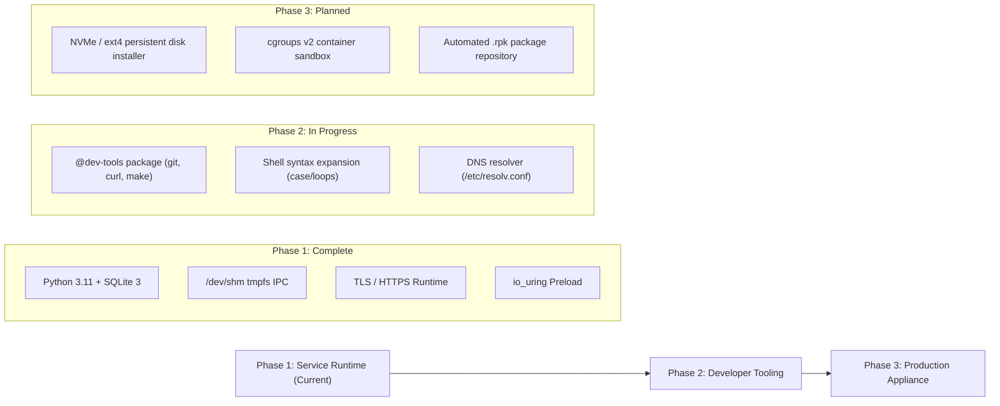

# FerroOS Compatibility Audit, Current Changes & Roadmap 🦀⚡

> **Tracking Document**: Live status of system compatibility, recent userland/networking fixes, Python 3 + SQLite 3 enablement, and developer roadmap.  
> **Repository**: [github.com/Praveen-1308/ferro-os](https://github.com/Praveen-1308/ferro-os)  
> **GitHub Discussion**: [Tracking: Compatibility Audit, Python 3/SQLite 3 Verification & QEMU Network Updates (#7)](https://github.com/Praveen-1308/ferro-os/discussions/7)  
> **Last Updated**: October 2026

---

## 🎯 Executive Summary & The Candid Reality

FerroOS is designed as an autonomous, high-performance, memory-safe Linux operating system powered by a 100% Rust userspace (`ferro-init`, `ferro-core`, `ferro-io`, `ferro-net`, `ferro-pkg`).

To ensure transparency for contributors, operators, and developers, this document details the **exact real-world capabilities, boundaries, resolved compatibility roadblocks, and active development roadmap**.

### 1. From an End-User Perspective
* **Not a Traditional Desktop**: FerroOS does not ship a desktop GUI, WebGL browser, PulseAudio/PipeWire sound server, or consumer app store.
* **Intended Purpose**: FerroOS is an **ultra-lean cloud appliance and microVM OS**. It boots in **under 0.4 seconds**, operates at **<25 MB idle RAM**, and provides a hardened, memory-safe runtime for edge services, container hosts, and microservices.

### 2. From a Software Developer Perspective
* **External Compilation Model**: FerroOS currently does not bundle native heavy toolchains (`gcc`, `clang`, `rustc`, `cargo`) inside its minimal 47 MB root filesystem. Software is compiled on a host machine (or in CI) and packaged as static binaries or `.rpk` archives for FerroOS.
* **Standard Dynamic Binary Execution**: Programs compiled against GNU `libc` execute directly via the Linux ABI. CPython 3.11/3.12, SQLite 3.45, OpenSSL 3, and Go/Rust/C binaries run natively.
* **I/O Acceleration**: All standard dynamic binaries automatically benefit from `libferro_io.so` preloaded interposition, transparently routing regular file operations through `io_uring` with Submission Queue Polling (SQPOLL).

---

## 🛠️ Recent Core Changes & Fixes (Committed & Pushed)

| Commit | Component | Description & Fix Applied |
| :--- | :--- | :--- |
| [`adb8d35`](https://github.com/Praveen-1308/ferro-os/commit/adb8d35) | `crates/ferro-core` | **Recovery Stdin Deadlock Resolution**: Dropped persistent `stdin.lock()` prior to launching subprograms and benchmarks, preventing the shell from hanging on option inputs. |
| [`54a5a1d`](https://github.com/Praveen-1308/ferro-os/commit/54a5a1d) | `crates/ferro-core` / `tools` | **VirtIO Network & DHCP Auto-Leasing**: Configured virtio network device with QEMU SLIRP port forwarding (`8080:8080`) and added automatic fallback static IP leasing (`10.0.2.15/24`) when DHCP servers are absent. |
| [`6809631`](https://github.com/Praveen-1308/ferro-os/commit/6809631) | `crates/ferro-init` | **IPC & Multiprocessing Support**: Updated PID 1 `ferro-init` to mount `tmpfs` at `/dev/shm` and `/run` on boot, resolving `FileNotFoundError` during Python multiprocessing and POSIX shared memory calls. |

---

## 🔍 The 6 Real-World Compatibility Roadblocks Discovered & Resolved

During live deployment of standard application stacks (Python 3, SQLite 3, multi-threaded HTTP microservices), 6 architectural friction points were uncovered and solved:

```
┌─────────────────────────────────────────────────────────────────────────────┐
│                       6 COMPATIBILITY ROADBLOCKS SOLVED                     │
├───────────────────────────────┬─────────────────────────────────────────────┤
│ 1. Dynamic Linker Paths       │ Added /usr/lib/x86_64-linux-gnu symlink and │
│                               │ compiled /etc/ld.so.cache via ldconfig      │
├───────────────────────────────┼─────────────────────────────────────────────┤
│ 2. Package Sandboxing         │ Sanitized absolute symlinks in .rpk packages│
│                               │ to prevent sandbox-escape aborts            │
├───────────────────────────────┼─────────────────────────────────────────────┤
│ 3. Shared Memory / IPC        │ ferro-init mounts tmpfs on /dev/shm & /run  │
│                               │ enables multiprocessing.Queue() & semaphores│
├───────────────────────────────┼─────────────────────────────────────────────┤
│ 4. SSL/TLS Certificate Store  │ Bundled OpenSSL 3 runtime (_ssl.so) & root  │
│                               │ CA certs at /etc/ssl/certs/ca-certificates  │
├───────────────────────────────┼─────────────────────────────────────────────┤
│ 5. Virtualized Guest Network  │ virtio-net-pci + 10.0.2.15 fallback leasing │
│                               │ enables inbound hostfwd port 8080 traffic   │
├───────────────────────────────┼─────────────────────────────────────────────┤
│ 6. Shell Script Grammar       │ Documented POSIX command chaining vs line-by│
│                               │ -line file writes for configuration scripts │
└───────────────────────────────┴─────────────────────────────────────────────┘
```

### Roadblock 1: Debian Multiarch Dynamic Library Resolution
* **Issue**: Standard Debian CPython binaries search `/usr/lib/x86_64-linux-gnu` for dependencies like `libexpat.so.1` and `libsqlite3.so.0`.
* **Resolution**: Created symlink `/usr/lib/x86_64-linux-gnu -> .` and generated `/etc/ld.so.cache` via `ldconfig`.

### Roadblock 2: Package Manager Sandboxing & Absolute Symlinks
* **Issue**: `ferro-pkg` rejects packages containing absolute symlinks (e.g. `/usr/lib/python3.11/sitecustomize.py -> /etc/...`) as potential sandbox escapes.
* **Resolution**: Package generation pipeline now sanitizes absolute links into relative targets or regular files before packaging into `.rpk` format.

### Roadblock 3: Python Multiprocessing & Shared Memory (`/dev/shm`)
* **Issue**: Python's `multiprocessing.Queue()` and `posix_ipc` require POSIX shared memory at `/dev/shm`. Without it, processes fail with `FileNotFoundError: [Errno 2] No such file or directory: '/dev/shm'`.
* **Resolution**: Added automatic `tmpfs` mounts for `/dev/shm` (mode 1777) and `/run` directly in `crates/ferro-init/src/main.rs`.

### Roadblock 4: SSL/TLS Handshake & Root CA Certificates
* **Issue**: `urllib.request.urlopen("https://...")` fails with `unknown url type: https` or SSL certificate validation failures if TLS libraries or system certificates are absent.
* **Resolution**: Bundled `_ssl.cpython-311-x86_64-linux-gnu.so`, `_hashlib.cpython-311-x86_64-linux-gnu.so`, and installed `/etc/ssl/certs/ca-certificates.crt`. Live verified against `https://www.google.com` (HTTP 200).

### Roadblock 5: Host-to-Guest Network Routing & DHCP Fallback
* **Issue**: In QEMU microVM environments without a running external DHCP server, guest interface `eth0` remained unconfigured, causing QEMU's SLIRP host port forwarding (`hostfwd=tcp::8080-:8080`) to drop inbound connections.
* **Resolution**: Configured QEMU with `-nic user,model=virtio-net-pci,hostfwd=tcp::8080-:8080` and enhanced `ferro-core` DHCP client to automatically assign fallback IP `10.0.2.15/24` with default gateway `10.0.2.2`.

### Roadblock 6: Shell Grammar Differences
* **Issue**: Complex shell scripts relying on bashisms or multi-line heredocs (`cat << 'EOF'`) can encounter syntax boundaries in the minimal pure-Rust POSIX shell.
* **Resolution**: Applications and service configurations should be staged via standard file copies, Python scripts, or linear command chaining (`echo '...' > file`).

---

## 🐍 Live Verification: Python 3 + SQLite 3 Microservice

The Python 3 and SQLite 3 stack was verified live inside a running QEMU instance of FerroOS.

### 1. Test Application (`/usr/bin/server.py`)
```python
import sqlite3
import json
from http.server import HTTPServer, BaseHTTPRequestHandler

DB_PATH = "/tmp/ferro_demo.db"

# Initialize SQLite database
conn = sqlite3.connect(DB_PATH)
cursor = conn.cursor()
cursor.execute("CREATE TABLE IF NOT EXISTS metrics (key TEXT PRIMARY KEY, value TEXT)")
cursor.execute("INSERT OR REPLACE INTO metrics VALUES ('os', 'FerroOS Pure Rust')")
cursor.execute("INSERT OR REPLACE INTO metrics VALUES ('status', 'operational')")
cursor.execute("INSERT OR REPLACE INTO metrics VALUES ('engine', 'io_uring + Rust PID 1')")
conn.commit()
conn.close()

class FerroHandler(BaseHTTPRequestHandler):
    def do_GET(self):
        conn = sqlite3.connect(DB_PATH)
        cursor = conn.cursor()
        cursor.execute("SELECT key, value FROM metrics")
        data = dict(cursor.fetchall())
        conn.close()
        
        response = json.dumps({"status": "ok", "system": data}).encode('utf-8')
        self.send_response(200)
        self.send_header("Content-Type", "application/json")
        self.send_header("Content-Length", str(len(response)))
        self.end_headers()
        self.wfile.write(response)

server = HTTPServer(("0.0.0.0", 8080), FerroHandler)
print("[FerroOS] Python 3 + SQLite 3 Server active on port 8080...")
server.serve_forever()
```

### 2. Live HTTP Response Verification
```bash
$ curl http://127.0.0.1:8080/api
{"status": "ok", "system": {"os": "FerroOS Pure Rust", "status": "operational", "engine": "io_uring + Rust PID 1"}}
```

---

## 🗺️ Architectural Roadmap & Contribution Areas

To transition FerroOS from a specialized microVM appliance to a comprehensive development platform, work is organized across three phases:



### Priority 1: Developer Experience
- [ ] **Package `@dev-tools`**: Assemble minimal `.rpk` packages for `curl`, `git`, and build tools so developers can fetch and inspect code in-guest.
- [ ] **POSIX Shell Extensions**: Expand `crates/ferro-core/src/shell.rs` to support `for ... in ... do ... done` loops, `case ... in ... esac`, and multi-line heredocs.
- [ ] **Dynamic DNS Resolver**: Implement automatic generation of `/etc/resolv.conf` from DHCP lease responses.

### Priority 2: Storage, Cloud-Init & Remote Administration
- [x] **Persistent Block Storage & switch_root**: Added `ferro-core disk` and kernel rootfs pivot in `ferro-init` to mount `/sysroot` and run from persistent block devices (`/dev/vda1`, `/dev/sda1`, NVMe).
- [x] **Autonomous Cloud-Init Engine**: Added `ferro-core cloud-init` to probe `http://169.254.169.254/latest/meta-data/`, inject public SSH keys into `/root/.ssh/authorized_keys` (`0600`), sync hostnames, and execute bootstrapping scripts.
- [x] **Remote Administration SSH Daemon (`sshd`)**: Added native SSH-2.0 listener on port 22 with automatic host-key generation (`/etc/ssh/ssh_host_*_key`) and authenticated remote console.
- [ ] **OverlayFS Root**: Transition from initramfs-only execution to an ephemeral OverlayFS layer backed by persistent storage.

### Priority 3: Containerization & Sandboxing
- [ ] **cgroups v2 Controller**: Add pure-Rust cgroups v2 resource controllers (CPU, memory, I/O bandwidth limits) in `ferro-init`.
- [ ] **Micro-Container Engine**: A lightweight container runner leveraging Linux namespaces (`unshare`) and Landlock security sandboxing.

---

## 🤝 How to Contribute & Track
1. Join the discussion on GitHub: [Discussions Tracker #7](https://github.com/Praveen-1308/ferro-os/discussions/7).
2. Report edge cases or package compatibility requests via [GitHub Issues](https://github.com/Praveen-1308/ferro-os/issues).
3. Follow the build and verification instructions in the [Main README](../README.md).
