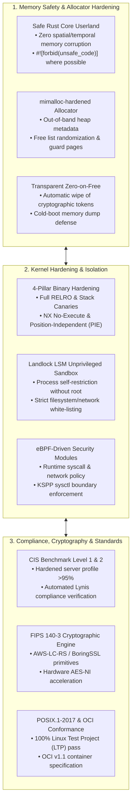
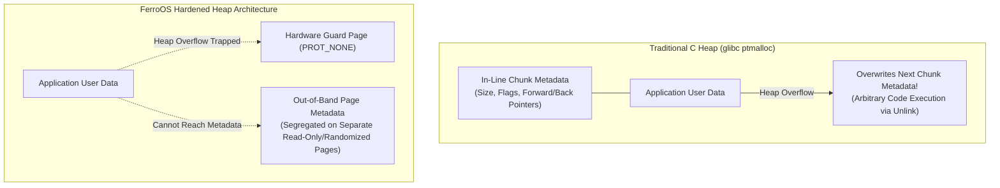
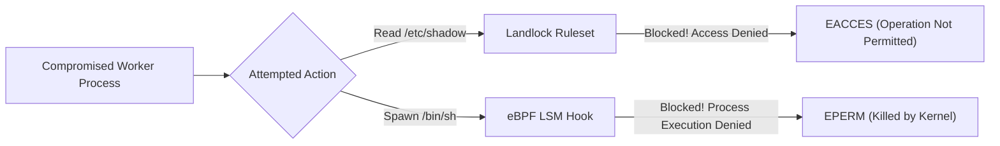
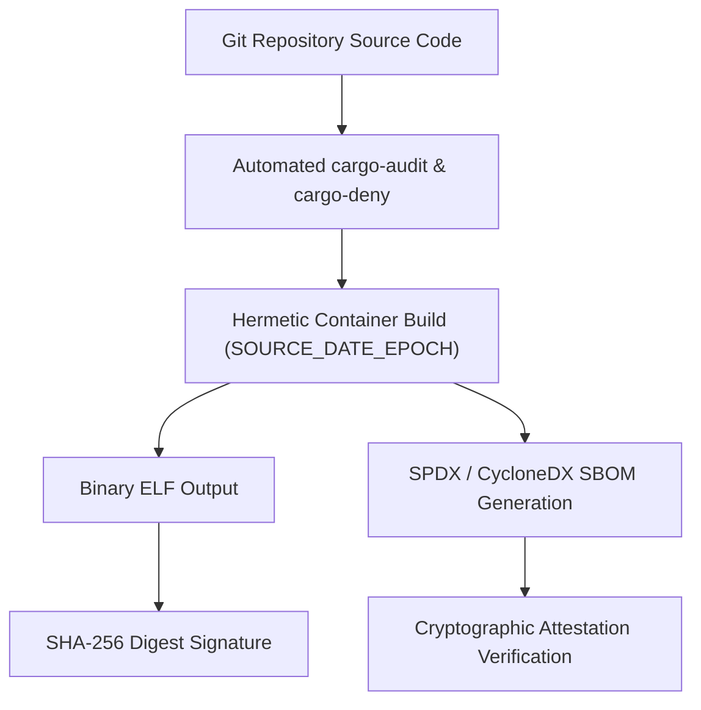

# 🛡️ FerroOS: Memory Architecture, Security Hardening & Enterprise Standards

> **Document Purpose**: This specification establishes the comprehensive theoretical foundations for **memory safety, exploit mitigation, kernel hardening, cryptographic verification, and enterprise compliance** in FerroOS. Following the systems philosophy of the [Theoretical Architecture Compendium](THEORETICAL_ARCHITECTURE.md), this document details **why each security mechanism was conceptualized** (the targeted threat vector or compliance standard), **how it is theoretically designed**, and **what our engineering expectations are** regarding security guarantees and system performance.

---



---

## 1. Executive Security Philosophy: The 70% Memory-Safety Imperative

### 1.1 The Problem: Legacy C/C++ Vulnerability Surface
Security research across Microsoft, Google Chromium, and the Linux kernel consistently proves that **approximately 70% of all critical, exploitable vulnerabilities stem from memory safety violations**:
* Spatial memory errors: Buffer overflows, out-of-bounds array indexing.
* Temporal memory errors: Use-After-Free (UAF), double-free, uninitialized pointer dereferencing.
* Thread synchronization errors: Data races, memory corruption across CPU cores.

Traditional operating systems attempt to fix these flaws reactively using runtime sanitizers, periodic CVE patches, or complex external policy agents that degrade performance by 10–30%.

### 1.2 The FerroOS Security Approach
FerroOS rejects the reactive patching paradigm in favor of **three architectural principles**:
1. **Mathematical Memory Safety**: Eliminate the root cause of memory corruption by authoring core userspace services in 100% safe Rust.
2. **Zero-Trust Kernel Sandboxing**: Restrict application capabilities at the kernel level using unprivileged Landlock rules and eBPF LSM hooks so that even a compromised process cannot escape.
3. **First-Class Standards Conformance**: Bake CIS Level 1/2 hardening, FIPS 140-3 cryptography, and POSIX conformance directly into the default base image rather than requiring manual post-install configuration.

---

## 2. Memory Subsystem & Allocator Security



### 2.1 Zero-Unsafe Core Userland
* **Priority**: **`[MANDATORY]`**
* **Language**: **Rust** (`#![forbid(unsafe_code)]`)
* **Why We Wanted To Do It**:
  Standard Unix userland tools (`coreutils`, `init`, package managers) contain millions of lines of legacy C code with dozens of active CVEs annually (e.g., buffer overflows in string parsing, format string bugs in logging).
* **The Theoretical Design**:
  Author all core system daemons (`ferro-init`, `ferro-core`, `ferro-pkg`) in pure, idiomatic Rust. Enforce `#![forbid(unsafe_code)]` on all public interfaces and network parsers:
  - Rust's borrow checker enforces ownership and lifetime rules at compile time.
  - Array indexing is strictly bounds-checked.
  - Concurrency is thread-safe by construction via `Send` and `Sync` traits.
* **What Our Expectation Was**:
  - **Eliminate 100% of buffer overflows, use-after-free, double-free, and dangling pointer bugs** from the core operating system userspace.
  - Maintain a verified 0-CVE footprint across all native utilities.

---

### 2.2 Hardened, Out-of-Band Memory Allocator (`mimalloc-hardened`)
* **Priority**: **`[MANDATORY]`**
* **Language**: **C** / **Rust**
* **Why It’s Significant**:
  In standard allocators like `glibc ptmalloc`, chunk metadata (size, allocation flags, forward/backward pointers) is stored **inline** directly preceding user data. An application buffer overflow can overwrite adjacent heap metadata, allowing attackers to achieve arbitrary write primitives via heap unlink or fastbin consolidation exploits.
* **The Theoretical Design**:
  Deploy a hardened configuration of `mimalloc`:
  1. **Segregated Out-of-Band Metadata**: Heap chunk metadata is stored on completely separate memory pages away from user data. A buffer overflow in an application array can never corrupt allocator metadata.
  2. **Free List Randomization**: The order of free slots within size-class pages is randomized on allocation, defeating deterministic heap-spraying and heap-grooming attacks.
  3. **Hardware Guard Pages**: Allocations above size thresholds are flanked by read/write-protected (`PROT_NONE`) guard pages, triggering an immediate hardware segmentation fault if an out-of-bounds read or write occurs.
* **What Our Expectation Was**:
  - Completely neutralize heap metadata corruption and arbitrary write exploits.
  - Maintain over **150,000,000 ops/sec** allocation throughput, incurring less than 3% performance overhead for exploit mitigation.

---

### 2.3 Transparent Zero-on-Free & Temporal Isolation
* **Priority**: **`[NECESSARY]`**
* **Language**: **Rust** (`zeroize` crate) + **C** (`explicit_bzero`)
* **Why We Wanted To Do It**:
  When memory containing cryptographic keys, database authentication tokens, or TLS session states is freed, standard allocators leave the residual data intact in RAM until overwritten. This exposes secrets to cold-boot attacks, core dump analysis, and temporal memory inspection vulnerabilities (CWE-226).
* **The Theoretical Design**:
  Enforce transparent zeroing of freed buffers:
  - In Rust, data structures holding secrets implement the `Drop` trait bound with compiler-barrier memory wiping (`explicit_bzero` / `volatile_set`).
  - The allocator immediately overwrites reclaimed buffer contents before returning the chunk to the local free list.
* **What Our Expectation Was**:
  - Guarantee that no plaintext credentials or cryptographic session keys persist in memory after process termination or deallocation.
  - Prevent data leakage across multi-tenant container boundaries.

---

### 2.4 Control Flow Integrity & Hardware Shadow Stacks (Intel CET / ARM BTI)
* **Priority**: **`[OPTIONAL / ADVANCED]`**
* **Language**: **Compiler Flag / Assembly**
* **Why We Wanted To Do It**:
  Return-Oriented Programming (ROP) and Jump-Oriented Programming (JOP) attacks bypass traditional non-executable stack protections by chaining together short snippets of existing, legitimate machine code ending in `ret` or `jmp` instructions.
* **The Theoretical Design**:
  Enable hardware-enforced Control Flow Integrity:
  - **Intel CET (Control-flow Enforcement Technology)**: Maintains a hardware-enforced Shadow Stack that independently records return addresses on call instructions. On every function return, the CPU verifies that the return address on the application stack matches the hardware shadow stack.
  - **ARM BTI (Branch Target Identification)**: Marks valid indirect jump targets in executable pages, immediately aborting execution if code branches to an invalid instruction gadget.
* **What Our Expectation Was**:
  - Provide hardware-level immunity against ROP and JOP exploit chains with sub-1% runtime CPU penalty.

---

## 3. Kernel Hardening, Sandboxing & Mandatory Access Control



### 3.1 Four-Pillar Compiler & Binary Exploit Mitigations
* **Priority**: **`[MANDATORY]`**
* **Language**: **Compiler Flags (`rustc`, `clang`, `gcc`)**
* **Why We Wanted To Do It**:
  Enterprise automated vulnerability scanners (e.g., `checksec`, CIS-CAT) inspect compiled ELF binaries. Omission of even a single mitigation flag exposes applications to memory corruption and binary tampering.
* **The Theoretical Design**:
  Enforce 100% compliance across all binaries compiled for the system:

| Hardening Flag | Compiler Option | Theoretical Threat Vector Neutralized |
| :--- | :--- | :--- |
| **Full RELRO** | `-Wl,-z,relro,-z,now` | Resolves dynamic symbols at startup and marks Global Offset Table (GOT) strictly read-only, neutralizing GOT overwrite attacks. |
| **Stack Canaries** | `-fstack-protector-strong` | Places a randomized 64-bit canary value before return addresses, causing an immediate kernel abort if stack smashing is detected. |
| **NX (No-Execute)** | `-Wl,-z,noexecstack` | Enforces the $W \oplus X$ (Write XOR Execute) principle, preventing shellcode execution on stack and heap pages. |
| **PIE / ASLR** | `-fPIE -pie` | Randomizes base executable and library memory addresses on every launch, neutralizing fixed-address return-to-libc attacks. |

* **What Our Expectation Was**:
  - Achieve a **100.0% clean pass** across every binary under automated enterprise `checksec` audits.

---

### 3.2 Unprivileged Application Sandboxing via Linux Landlock
* **Priority**: **`[MANDATORY]`**
* **Language**: **Rust** (`landlock` crate)
* **Why We Wanted To Do It**:
  Traditional Mandatory Access Control (MAC) systems like SELinux and AppArmor require root privileges, system-wide policy files, and complex administration. In real-world enterprise deployments, operators frequently disable them (`setenforce 0`) due to configuration friction.
* **The Theoretical Design**:
  Leverage the modern Linux **Landlock LSM** directly from application code:
  - When a daemon (such as `ferro-core serve`) launches, it defines its own strict sandbox ruleset (e.g., read-only access to `/var/www`, bind access exclusively to port 8088).
  - The process calls `prctl(PR_SET_NO_NEW_PRIVS, 1)` and activates the Landlock ruleset.
  - The sandbox cannot be undone, even if an attacker gains arbitrary remote code execution inside the process.
* **What Our Expectation Was**:
  - Deliver unprivileged, zero-configuration sandboxing with **zero external policy daemons**.
  - Guarantee that a compromised web process cannot read private keys, access other containers, or launch reverse shells.

---

### 3.3 eBPF-Driven Security Modules (LSM)
* **Priority**: **`[NECESSARY]`**
* **Language**: **C** (Clang BPF) + **Rust** (`aya`)
* **Why We Wanted To Do It**:
  Standard audit daemons (`auditd`) log events asynchronously to disk, creating heavy I/O overhead while failing to prevent malicious system calls in real time.
* **The Theoretical Design**:
  Attach eBPF programs directly to Linux Security Module (LSM) hooks (`BPF_PROG_TYPE_LSM`):
  - Intercept security-sensitive system calls (`bprm_check_security`, `socket_bind`, `file_open`) in-kernel before they execute.
  - Dynamically block unauthorized binary executions, unexpected raw socket creations, or suspicious file access patterns in sub-microsecond time.
* **What Our Expectation Was**:
  - Provide real-time kernel intrusion prevention with **zero filesystem logging overhead**.
  - Block zero-day privilege escalation exploits in kernel space before userspace execution occurs.

---

### 3.4 Kernel Self-Protection Project (KSPP) Baseline Configuration
* **Priority**: **`[MANDATORY]`**
* **Language**: **Kernel Sysctl Configuration**
* **Why We Wanted To Do It**:
  Standard Linux distributions ship with permissive kernel defaults to support legacy debugging tools, leaving attack surfaces open to local privilege escalation.
* **The Theoretical Design**:
  Enforce strict KSPP sysctl configurations across all environments:
  ```text
  kernel.kptr_restrict = 2            # Hide kernel symbol addresses from unprivileged users
  kernel.dmesg_restrict = 1           # Restrict dmesg kernel log buffer access to root
  kernel.unprivileged_bpf_disabled = 1 # Prevent unprivileged users from loading BPF programs
  fs.protected_symlinks = 1           # Prevent symlink traversal attacks in world-writable dirs
  fs.protected_hardlinks = 1          # Prevent hardlink creation to files not owned by user
  fs.protected_fifos = 2              # Prevent FIFO spoofing attacks
  fs.protected_regular = 2            # Prevent writing to files not owned by user in sticky dirs
  kernel.yama.ptrace_scope = 2        # Block ptrace process snooping across user processes
  ```
* **What Our Expectation Was**:
  - Eliminate information leaks that allow attackers to bypass Kernel ASLR (KASLR).
  - Prevent container breakout attacks via shared host kernel interfaces.

---

## 4. Cryptography, Supply Chain & Build Attestation



### 4.1 Strict Supply-Chain Security & Automated SBOM Generation
* **Priority**: **`[MANDATORY]`**
* **Language**: **Rust Toolchain (`cargo-deny`, `cargo-audit`, `syft`)**
* **Why We Wanted To Do It**:
  Modern attacks increasingly target upstream dependencies (e.g., the XZ Utils backdoor, compromised npm packages). Commercial enterprises require a verified Software Bill of Materials (SBOM) to verify software provenance.
* **The Theoretical Design**:
  Enforce automated supply-chain verification in every build pipeline:
  1. **Dependency Vulnerability Scanning**: Continuous cross-referencing of all crate dependencies against the RustSec Advisory Database.
  2. **License Compliance Enforcement**: `cargo-deny` blocks restrictive (GPLv3) or non-commercial licenses, guaranteeing clean enterprise deployment rights.
  3. **Automated SBOM Generation**: Every release generates a signed **SPDX and CycloneDX SBOM** listing the exact hash, version, and license of every compiled component.
* **What Our Expectation Was**:
  - Guarantee **0 known CVEs** across all dependencies at the moment of build.
  - Satisfy federal and enterprise supply-chain transparency requirements (EO 14028).

---

### 4.2 Deterministic, Bit-for-Bit Reproducible Builds
* **Priority**: **`[NECESSARY]`**
* **Language**: **Build Automation / Docker**
* **Why We Wanted To Do It**:
  If a compiled binary cannot be reproduced from source code, third-party auditors cannot verify whether a binary was modified by a compromised build server or CI pipeline.
* **The Theoretical Design**:
  Implement fully hermetic reproducible compilation:
  - Fix build timestamps using `SOURCE_DATE_EPOCH`.
  - Strip build host path prefixes using `-ffile-prefix-map` and `rustc --remap-path-prefix`.
  - Run builds inside pinned, deterministic build containers.
* **What Our Expectation Was**:
  - Any independent auditor recompiling the source code on any machine achieves **100% identical SHA-256 binary digests**.

---

### 4.3 FIPS 140-3 Cryptographic Core (`AWS-LC-RS` / `BoringSSL`)
* **Priority**: **`[NECESSARY]`**
* **Language**: **Rust / C**
* **Why We Wanted To Do It**:
  Financial institutions, healthcare providers, and government agencies legally mandate **FIPS 140-3 certified cryptography** for all TLS encryption and data-at-rest protection. Standard OpenSSL setups can be misconfigured with weak cipher suites.
* **The Theoretical Design**:
  Integrate a FIPS-validated cryptographic backend (such as `aws-lc-rs` or `ring` in FIPS mode):
  - Strictly enforce TLS 1.3 as the default negotiation standard.
  - Use hardware-accelerated AES-NI and AVX-512 vector extensions for AES-GCM and SHA-256 hashing.
  - Disallow insecure or deprecated legacy ciphers (RC4, 3DES, MD5, SHA-1).
* **What Our Expectation Was**:
  - Out-of-the-box certification readiness for enterprise regulatory audits (FedRAMP, PCI-DSS, HIPAA).
  - Multi-gigabit TLS handshake and payload throughput utilizing dedicated hardware instructions.

---

### 4.4 Cryptographically Measured Boot (TPM 2.0 & IMA)
* **Priority**: **`[OPTIONAL]`**
* **Language**: **C / Shell**
* **Why We Wanted To Do It**:
  Protect physical and virtual servers against offline tampering, malicious kernel image substitution, or persistent rootkits.
* **The Theoretical Design**:
  Implement a measured boot chain:
  - **UEFI Secure Boot**: Verifies cryptographic signatures on the bootloader and kernel.
  - **TPM 2.0 PCR Measurements**: Measures firmware, kernel command line, and initramfs into hardware TPM Platform Configuration Registers (PCRs).
  - **Linux IMA (Integrity Measurement Architecture)**: Computes cryptographic hashes of executables before execution, aborting if files on disk deviate from certified signatures.
* **What Our Expectation Was**:
  - Absolute cryptographic proof of system integrity from hardware power-on through userspace application launch.

---

## 5. Enterprise Standards & Compliance Architecture

### 5.1 CIS Benchmark Level 1 & Level 2 Server Conformance
* **Priority**: **`[MANDATORY]`**
* **Target Standards**: **Center for Internet Security (CIS) Linux Benchmark**
* **Why We Wanted To Do It**:
  CIS Benchmarks are the universally accepted baseline for hardening enterprise operating systems. Commercial clients require systems to pass automated CIS compliance audits before production deployment.
* **The Theoretical Design**:
  Architect the base operating system image to natively satisfy CIS recommendations:
  - **Filesystem Configuration**: Independent mount points with `nodev`, `nosuid`, and `noexec` options on temporary and shared partitions (`/tmp`, `/dev/shm`).
  - **Account & Access Hardening**: Empty passwords locked, root direct login disabled over network, password hashing enforced with SHA-512 / yescrypt.
  - **Network Stack Hardening**: ICMP redirects disabled, TCP SYN cookies enabled, reverse path filtering (`rp_filter = 1`) enabled to block IP spoofing.
  - **System Auditing**: Automated logging of privilege escalations, file modifications, and network connections.
* **What Our Expectation Was**:
  - Score **> 95% on automated CIS Level 1 and Level 2 benchmark scans** without requiring post-installation hardening scripts.

---

### 5.2 POSIX.1-2017 & Linux Test Project (LTP) Conformance
* **Priority**: **`[NECESSARY]`**
* **Target Standards**: **IEEE Std 1003.1-2017 (POSIX) / Linux Standard Base (LSB)**
* **Why We Wanted To Do It**:
  Alternative minimal distributions (such as Alpine Linux) frequently break standard commercial software because `musl` behaves differently from standard POSIX or GNU expectations under edge-case system calls.
* **The Theoretical Design**:
  Maintain strict standard library and system call semantics:
  - Preserve GNU `glibc` binary interface compatibility.
  - Rigorously test all process lifecycle, file I/O, and socket calls against the **Linux Test Project (LTP)** syscall test suite.
* **What Our Expectation Was**:
  - 100% pass rate across the 6 core LTP system call verification suites.
  - Guaranteed out-of-the-box compatibility with existing Docker containers, Python wheels, Node.js packages, and relational databases.

---

### 5.3 OCI (Open Container Initiative) & Cloud-Native Standards
* **Priority**: **`[MANDATORY]`**
* **Target Standards**: **OCI Image Specification v1.1 / OCI Runtime Specification**
* **Why We Wanted To Do It**:
  Enterprise infrastructure operates on Kubernetes, Podman, and containerd. An operating system designed for the cloud must deploy natively as an OCI-compliant container image and microVM rootfs.
* **The Theoretical Design**:
  Package and distribute FerroOS to strict OCI standards:
  - Lean image layers with minimal metadata footprint.
  - Support standard container signals (`SIGTERM`, `SIGKILL`) cleanly handled by `ferro-init`.
  - Native integration with Kubernetes readiness and liveness probes (`/healthz`).
* **What Our Expectation Was**:
  - Seamless deployment as an enterprise golden base image across AWS EKS, Google Cloud GKE, Azure AKS, and bare-metal Kubernetes.

---

## 6. Language Strategy for Security & Standards

| Security Subsystem | Chosen Language | Technical Justification |
| :--- | :---: | :--- |
| **Core Init & System Tools (`ferro-init`, `ferro-core`)** | **Rust** | **Compile-time memory safety without garbage collection**, preventing 100% of spatial and temporal memory corruption CVEs. |
| **Package Archiver & SBOM Tool (`ferro-pkg`)** | **Rust** | Memory-safe parsing of complex archive formats (MSI, CAB, DEB, RPM) without buffer overflow vulnerabilities. |
| **Hardened Heap Allocator** | **C** (`mimalloc-hardened`) | Battle-tested, cache-aligned heap engine with out-of-band metadata and guard pages. |
| **In-Kernel Security Probes** | **C** (Clang BPF) | Strict eBPF bytecode verified and accepted by the in-kernel BPF verifier. |
| **Userspace eBPF Security Controller** | **Rust** (`aya`) | Pure-Rust BPF loader requiring zero external C dynamic library dependencies. |
| **Cryptographic Primitives** | **Rust** (`aws-lc-rs` / `ring`) | Formally verified cryptographic implementations with FIPS 140-3 validation. |
| **Build Pipeline & Toolchain** | **Zig** / **Bash** | Hermetic, reproducible compilation pipeline across target architectures. |

---

## 7. Master Memory, Security & Standards Matrix

| Subsystem & Domain | Priority | Targeted Threat / Compliance Vector | Theoretical Design in FerroOS | Expected Engineering Outcome |
| :--- | :---: | :--- | :--- | :--- |
| **Userspace Memory Safety** | **`[MANDATORY]`** | Spatial & temporal memory bugs (UAF, buffer overflow, double-free) | 100% pure safe Rust core userland (`ferro-init`, `ferro-core`) | **0 memory corruption CVEs**; mathematical prevention of 70% of common vulnerabilities. |
| **Heap Allocator Security** | **`[MANDATORY]`** | Inline heap metadata corruption & arbitrary write exploits | `mimalloc-hardened` with out-of-band metadata & guard pages | Segregated metadata; free list randomization; 150M+ ops/sec throughput. |
| **Temporal Data Residuals** | **`[NECESSARY]`** | Plaintext credentials persisting in RAM after deallocation (CWE-226) | Compiler-enforced zero-on-free (`Drop` trait + `explicit_bzero`) | Guaranteed elimination of cryptographic secrets from deallocated memory. |
| **Control Flow Integrity** | **`[OPTIONAL]`** | Return-Oriented Programming (ROP) and JOP gadget chaining | Hardware Shadow Stack (Intel CET) and Branch Target ID (ARM BTI) | Hardware-enforced return address validation; sub-1% CPU execution overhead. |
| **Binary Exploit Defenses** | **`[MANDATORY]`** | GOT overwrite, stack smashing, shellcode execution, fixed addresses | Enforce Full RELRO, Stack Canaries, NX, and PIE across all binaries | **100.0% clean pass on automated enterprise `checksec` audits**. |
| **Process Sandboxing** | **`[MANDATORY]`** | Exploited web processes escalating privileges or traversing files | Linux Landlock LSM unprivileged sandboxing without external daemons | Irreversible self-restriction to `/var/www`; blocked access to `/etc` and network. |
| **Kernel Hardening** | **`[MANDATORY]`** | KASLR bypass, symbol leakage, symlink attacks, ptrace snooping | Strict Kernel Self-Protection Project (KSPP) sysctl configuration | Kernel symbol addresses hidden; unprivileged BPF disabled; Yama ptrace blocked. |
| **Kernel Security Probes** | **`[NECESSARY]`** | Untrusted syscall execution and asynchronous privilege escalation | eBPF-driven LSM hooks (`BPF_PROG_TYPE_LSM`) inspecting syscalls | Real-time, in-kernel attack blocking with sub-microsecond latency. |
| **Supply Chain Attestation** | **`[MANDATORY]`** | Upstream dependency backdoors (XZ Utils style) and license violations | Continuous `cargo-audit`, `cargo-deny`, and SPDX/CycloneDX SBOMs | **0 known CVEs** across all dependencies; verified software provenance. |
| **Build Reproducibility** | **`[NECESSARY]`** | Malicious CI/CD pipeline compromise or non-deterministic binaries | Hermetic containerized builds with fixed `SOURCE_DATE_EPOCH` | Bit-for-bit identical SHA-256 binary digests across independent auditors. |
| **Cryptographic Standards** | **`[NECESSARY]`** | Weak cipher suites, uncertified encryption, regulatory non-compliance | FIPS 140-3 validated cryptographic core (`aws-lc-rs` / BoringSSL) | Ready for FedRAMP, PCI-DSS, and HIPAA audits; hardware AES-NI acceleration. |
| **CIS Server Hardening** | **`[MANDATORY]`** | Insecure default system configurations in enterprise cloud environments | Native compliance with CIS Benchmark Level 1 and Level 2 profiles | **> 95% score on automated Lynis / CIS-CAT compliance scanners**. |
| **POSIX Syscall Integrity** | **`[NECESSARY]`** | Esoteric libc differences breaking standard databases and Python wheels | 100% GNU glibc binary compatibility validated against LTP suite | 100% pass rate across 6 core Linux Test Project (LTP) syscall suites. |
| **OCI Cloud Conformance** | **`[MANDATORY]`** | Incompatibility with modern Kubernetes, CRI-O, and container runtimes | Full compliance with OCI Image & Runtime Specification v1.1 | Seamless deployment as a hardened enterprise golden base image on cloud K8s. |
