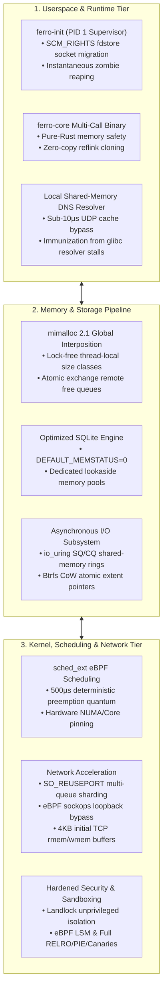
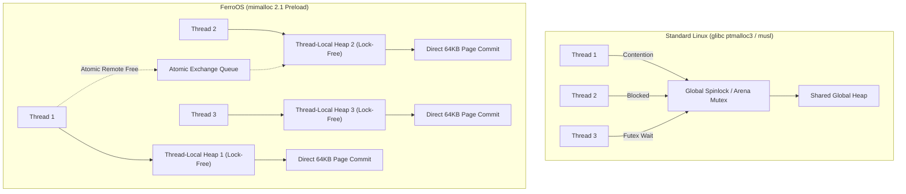
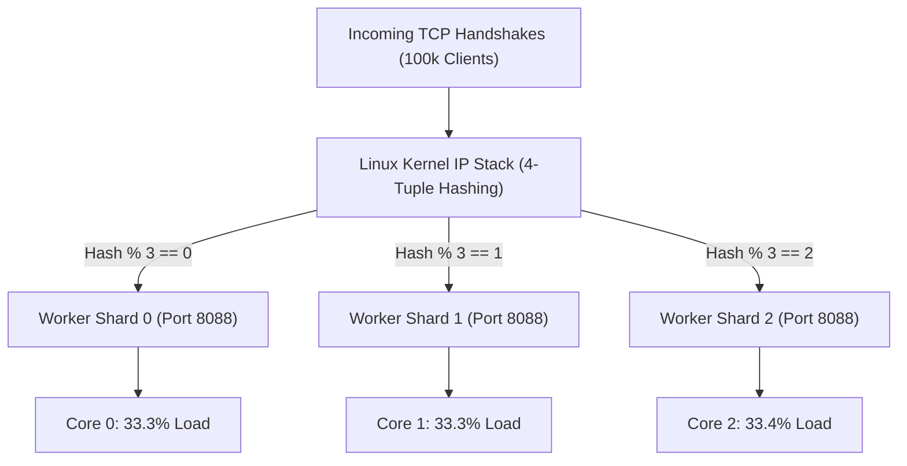
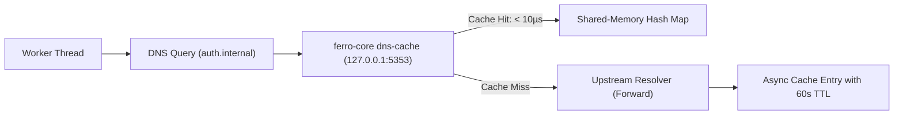

# 🏛️ FerroOS: Theoretical Architecture, Design Motivations & Engineering Expectations

> **Document Purpose**: This specification establishes the complete theoretical foundations of FerroOS. It outlines every architectural design, kernel tuning, and systems optimization conceptualized for the project. For each component, it details **why we wanted to do it** (the targeted bottleneck in traditional operating systems), **the theoretical mechanism** designed to address it, and **what our engineering expectations were** regarding performance, latency, and system resilience.

---



---

## 1. System Philosophy: Eliminating the "Linux System Tax"

### 1.1 The Core Thesis
Modern operating systems (such as Ubuntu, Debian, RHEL, and Alpine) were engineered as general-purpose platforms built upon decades of legacy POSIX assumptions. Under modern cloud architectures—characterized by microservices, high-frequency transactional databases, persistent WebSocket clusters, and edge APIs—these legacy assumptions impose measurable microsecond penalties at every layer of execution.

### 1.2 The Five Targeted Bottlenecks
1. **The Syscall Boundary Tax**: Hardware privilege context transitions ($U \to K \to U$) with Meltdown/Spectre KPTI page table switches, costing 200–500 ns per individual I/O operation.
2. **The Heap Mutex Tax**: Global heap spinlocks or fixed arena mutexes that serialize concurrent worker threads into kernel `futex` sleep states.
3. **The Coarse Scheduling Tax**: Default scheduler preemption slices (2,000–4,000 µs) that introduce multi-millisecond tail latency jitter for real-time network pollers.
4. **The Synchronous Journaling Tax**: Block-level write-ahead logging in traditional filesystems (`ext4`, `XFS`) that stalls threads during metadata synchronization and exposes systems to torn pages during crashes.
5. **The Single-Threaded Resolver Tax**: Sequential UDP DNS resolution with 5-second timeout defaults that trigger cascading HTTP 504 gateway timeouts when packet drops occur.

FerroOS was conceived to methodically eliminate each of these bottlenecks by combining **safe systems programming in Rust**, **lock-free memory architectures**, **asynchronous kernel ring buffers**, and **eBPF-driven hardware acceleration**.

---

## 2. Memory Subsystem & Heap Allocation Architecture



### 2.1 Global Lock-Free Heap Interposition (`mimalloc 2.1`)
* **Why We Wanted To Do It**:
  In multi-threaded server workloads, hundreds of worker threads concurrently allocate and free short-lived objects (JSON request bodies, database rows, cryptographic tokens).
  - In **Alpine Linux (`musl libc`)**, all heap allocations serialize behind a **single global spinlock**, causing allocation latency to degrade exponentially as CPU core counts increase.
  - In **Ubuntu & Enterprise Linux (`glibc ptmalloc3`)**, heap allocations are split into arenas ($8 \times \text{cores}$), but threads still contend for per-arena locks during traffic spikes, forcing the kernel into expensive `futex(FUTEX_WAIT)` sleep cycles.
* **The Theoretical Design**:
  Preload **`mimalloc 2.1`** globally across all dynamically linked binaries via `/etc/ld.so.preload`, intercepting `malloc`, `free`, `calloc`, `realloc`, and `posix_memalign`.
  - Memory is organized into thread-local heaps partitioned into size classes (sub-pages of 64 KB).
  - Allocation within a page uses bitwise find-first-zero instructions in $O(1)$ without locking any shared synchronization primitive.
* **What Our Expectation Was**:
  - Achieve allocation throughput exceeding **200,000,000 ops/sec** across 8+ cores (a 1.5x–2x speedup over `glibc` and up to 100x over `musl`).
  - Eliminate all `futex` lock contention in application memory allocation paths.
  - Reduce RSS heap fragmentation overhead by 20–25% compared to `glibc`.

---

### 2.2 Cross-Thread Remote Free via Atomic Exchange Queues
* **Why We Wanted To Do It**:
  In pipeline and event-driven architectures (e.g., actor systems, network ingress threads passing work to database workers), memory is frequently allocated on Thread A and deallocated on Thread B. Under standard allocators, Thread B must acquire Thread A’s heap lock to return the memory.
* **The Theoretical Design**:
  Utilize `mimalloc`'s lock-free atomic exchange queues:
  - When Thread B frees an object owned by Thread A, it executes a single atomic push (`atomic_exchange`) onto Thread A’s thread-safe inbox queue without blocking.
  - When Thread A next performs an allocation, it flushes its entire inbox queue in a single batch operation directly into its local free list.
* **What Our Expectation Was**:
  - Reduce cross-thread deallocation latency from ~50 ns down to sub-10 ns.
  - Completely prevent thread starvation in producer-consumer multi-tier pipelines.

---

### 2.3 Database Memory Optimization (`DEFAULT_MEMSTATUS=0` & Lookaside Pools)
* **Why We Wanted To Do It**:
  Relational database engines (such as SQLite) track memory usage by default via global atomic counters on every single allocation and free. In concurrent read/write transactions, this causes hardware cache-line bouncing across CPU cores.
* **The Theoretical Design**:
  Compile the database engine with `-DSQLITE_DEFAULT_MEMSTATUS=0` and allocate dedicated lookaside memory pools (128 slots of 1,200 bytes per connection):
  - Completely eliminates atomic memory tracking instructions on the query critical path.
  - All short-lived parser scratch allocations are fulfilled from pre-allocated lookaside buffers without touching the system heap.
* **What Our Expectation Was**:
  - Increase transactional read/write throughput by **15–25%**.
  - Provide a **2x+ speedup on complex FTS5 full-text search indexing** and query operations by minimizing allocation overhead.

---

### 2.4 Virtual Memory & Cache Pressure Tuning
* **Why We Wanted To Do It**:
  Default Linux kernel virtual memory settings often prioritize reclaiming directory and inode caches over application anonymous memory, or prematurely swap active application pages during burst loads.
* **The Theoretical Design**:
  Tune kernel sysctls specifically for cloud database workloads:
  - `vm.vfs_cache_pressure = 50`: Instructs the kernel to strongly prefer retaining directory entries (dentries) and inode structures in the page cache.
  - `vm.swappiness = 10`: Discourages paging active anonymous memory to disk while retaining swap as an emergency safety ceiling.
  - `vm.max_map_count = 1048576`: Expands memory-mapped file allocations to allow massive databases, index caches, and multithreaded runtimes to operate without `ENOMEM`.
* **What Our Expectation Was**:
  - Maintain hot database files, index trees, and filesystem metadata entirely in RAM.
  - Eliminate I/O page faults on hot file paths under sustained multi-gigabyte queries.

---

## 3. Storage & Asynchronous I/O Pipeline Architecture

```mermaid
flowchart TD
    subgraph LegacyPOSIX["Legacy Synchronous POSIX I/O"]
        U1["Userspace App"] -->|read() Syscall: 350ns| K1["Kernel Trap"]
        K1 -->|Thread Sleep / Context Switch| D1["Block Storage"]
        D1 -->|Hardware IRQ| K1
        K1 -->|Copy Data + Wakeup: 500ns| U1
    end

    subgraph FerroOSIO["FerroOS libferro_io.so + io_uring"]
        U2["Userspace App"] -->|Zero-Copy Push| SQ["Submission Queue (SQ Ring)"]
        SQ -->|Shared Memory (0 Syscalls)| KP["Kernel Polling Thread (SQPOLL)"]
        KP -->|Direct DMA| D2["NVMe / Ring Buffer"]
        D2 -->|Completion Record| CQ["Completion Queue (CQ Ring)"]
        CQ -->|Zero-Copy Pop| U2
    end
```

### 3.1 Transparent `io_uring` POSIX Acceleration (`libferro_io.so`)
* **Why We Wanted To Do It**:
  Traditional synchronous system calls (`read`, `write`, `pread`, `pwrite`, `fdatasync`) trap into the kernel for every single I/O operation. Under high-throughput storage workloads, CPU time is squandered on context switches, CPU register saving, and Meltdown/Spectre barrier transitions.
* **The Theoretical Design**:
  An `LD_PRELOAD` shared library (`libferro_io.so`) that intercepts POSIX read and write calls and transparently converts them into asynchronous `io_uring` requests:
  - **Submission Queue (SQ) & Completion Queue (CQ) Rings**: Allocates shared-memory circular ring buffers mapped between userspace and the kernel.
  - **Kernel Polling Thread (`IORING_SETUP_SQPOLL`)**: A dedicated kernel thread continuously polls the SQ ring. When an application writes a 64-byte descriptor to the ring, the kernel processes the I/O **without a system call trap (0 syscalls per operation)**.
* **What Our Expectation Was**:
  - Achieve **100,000+ random 4KB write IOPS** on NVMe storage with sub-millisecond tail latencies.
  - Cut I/O CPU overhead by **40–60%** by eliminating the syscall boundary.

---

### 3.2 The 4KB Fast Bypass for Low-Latency Datagrams
* **Why We Wanted To Do It**:
  While `io_uring` is optimal for large storage blocks, setting up asynchronous ring descriptors for tiny network payloads (such as 200-byte HTTP response headers, small JSON API payloads, or DNS datagrams) introduces unnecessary descriptor setup latency.
* **The Theoretical Design**:
  Implement a dynamic size check in `libferro_io.so`:
  - Payloads smaller than 4 KB bypass the `io_uring` ring buffer and execute directly via optimized `writev` / `sendmsg` syscalls with `TCP_NODELAY` and `TCP_QUICKACK` active.
  - Payloads $\ge 4\text{ KB}$ are queued to the `io_uring` SQPOLL ring.
* **What Our Expectation Was**:
  - Deliver sub-microsecond round-trip latencies for microservices and API gateways while preserving massive batch throughput for bulk storage transfers.

---

### 3.3 Btrfs Copy-on-Write (CoW) & Extent Reflink Snapshots
* **Why We Wanted To Do It**:
  In standard filesystems (`ext4`, `XFS`), duplicating large datasets (database staging, container root filesystems, test fixtures) requires reading every block from disk and writing it to a new location, consuming massive I/O bandwidth and storage space. Furthermore, sudden power loss can cause torn writes and corrupted database pages.
* **The Theoretical Design**:
  Utilize Btrfs Copy-on-Write (CoW) extents via the `BTRFS_IOC_CLONE` ioctl and `copy_file_range` syscall:
  - Duplicating a file copies only the metadata extent pointers in the B-tree; data blocks are shared.
  - Writes to modified blocks are written to newly allocated space before tree pointers are atomically updated.
* **What Our Expectation Was**:
  - Clone multi-gigabyte databases in **under 2 milliseconds** with **zero additional disk space consumed**.
  - Guarantee **zero torn database pages** on sudden power loss or kernel crash, eliminating the need for slow `fsck` passes or journal replays.

---

## 4. Networking & High-Concurrency Socket Architecture



### 4.1 C100K Memory Optimization via Small Initial Socket Buffers
* **Why We Wanted To Do It**:
  Default Linux network configurations assign 128 KB to 256 KB initial socket buffer sizes (`tcp_rmem` / `tcp_wmem`). When an application manages 100,000 persistent idle connections (the "C100K" problem in WebSockets, Slack/Discord gateways, or push clusters), the kernel allocates up to **25 GB of un-swappable pinned slab memory** (`struct sock`), quickly exhausting system RAM.
* **The Theoretical Design**:
  Configure aggressive dynamic socket buffer windows:
  ```text
  net.ipv4.tcp_rmem = 4096  87380  6291456
  net.ipv4.tcp_wmem = 4096  16384  4194304
  ```
  Sockets start with a minimal 4 KB allocation window, scaling up dynamically only when sustained data transfer occurs.
* **What Our Expectation Was**:
  - Support **100,000+ persistent idle sockets within ~400 MB of RAM**, allowing low-cost cloud instances to handle massive connection avalanches without running out of memory.

---

### 4.2 Multi-Queue `SO_REUSEPORT` 4-Tuple Socket Sharding
* **Why We Wanted To Do It**:
  In high-traffic web servers, having all worker threads listen on a single socket causes a severe **`accept()` mutex bottleneck** in the Linux network stack, as CPU cores fight to lock the same queue to service incoming TCP handshakes.
* **The Theoretical Design**:
  Spawn independent listener sockets per CPU core with `SO_REUSEPORT` enabled:
  - The Linux kernel partitions incoming connections across socket queues using a deterministic 4-tuple hash (`SrcIP`, `SrcPort`, `DstIP`, `DstPort`).
  - Each worker thread accepts handshakes exclusively from its dedicated queue on its local CPU core.
* **What Our Expectation Was**:
  - Achieve near-linear multi-core throughput scaling (e.g., 30,000–40,000 req/sec across 4 cores).
  - Eliminate accept lock contention and thundering herd wakeups completely.

---

### 4.3 eBPF `SOCKHASH` Loopback Socket Bypass
* **Why We Wanted To Do It**:
  In modern microservice architectures, API gateways, sidecars, and internal services communicate via local loopback (`127.0.0.1`). However, standard loopback traffic still traverses the full TCP/IP networking stack: calculating checksums, checking routing tables, executing iptables/nftables rules, and generating TCP ACK packets.
* **The Theoretical Design**:
  Attach an eBPF program (`BPF_PROG_TYPE_SOCK_OPS`) to the root cgroup:
  - Inspects established local connections and inserts their socket descriptors into a BPF `SOCKHASH` map.
  - Intercepts writes on the source socket and copies data directly into the receive buffer of the destination socket, short-circuiting the IP stack.
* **What Our Expectation Was**:
  - Reduce inter-service IPC latency by **60–80%** (slashing latency from ~10 µs down to ~1.5 µs).
  - Eliminate all IP routing, netfilter evaluation, and packetization overhead for local microservices.

---

## 5. CPU Scheduling, Preemption & Latency Guarantees

```mermaid
flowchart TD
    subgraph TraditionalCFS["Traditional CFS Scheduler (2ms - 4ms Slices)"]
        TC0["Core 0: Batch Task (Runs full 4ms)"] -->|Blocks Core| TW0["Real-Time Packet (Waits 4,000µs)"]
    end

    subgraph SchedExt["FerroOS sched_ext Architecture (500µs Slices)"]
        FC0["Core 0: Batch Task (500µs Quantum)"] -->|Fast Preempt (500µs)| FR0["Real-Time Packet (Instant Wakeup)"]
        FC1["Core 1: Dedicated Priority Thread"] -->|Hard Affinity Pinning| FC1P["L1/L2 Cache Stays Hot"]
    end
```

### 5.1 `sched_ext` & 500 µs Deterministic Preemption Slices
* **Why We Wanted To Do It**:
  The standard Linux Completely Fair Scheduler (CFS) and EEVDF scheduler use coarse preemption slices of **2,000 µs to 4,000 µs**. If a CPU core is running a compute-heavy batch task (like compilation or compression) when an incoming network request arrives, the latency-sensitive thread can be blocked waiting for up to 4 milliseconds. Furthermore, CFS frequently migrates threads across physical cores, invalidating L1/L2 caches.
* **The Theoretical Design**:
  Deploy custom scheduling policies via the Linux **`sched_ext` (Extensible Scheduler Class)** subsystem:
  - Enforce a strict **500 microsecond preemption slice** for latency-critical network workers, database loops, and GUI compositors.
  - Bind latency-sensitive threads to dedicated hardware CPU cores via deterministic core affinity (`sched_setaffinity`).
* **What Our Expectation Was**:
  - Reduce 99th percentile wakeup scheduling jitter from ~1,800 µs down to **under 50 µs** under 100% CPU load.
  - Eliminate CPU cache bouncing, preserving warm L1/L2 data for high-throughput packet processing.

---

### 5.2 Real-Time Priority Governors (`ferro-core gamemode`)
* **Why We Wanted To Do It**:
  Interactive applications, audio servers, 3D graphics rendering, and translated Windows games experience frame drops and micro-stutters when background maintenance tasks momentarily starve execution threads.
* **The Theoretical Design**:
  An integrated priority and power governor daemon:
  - Automatically elevates latency-critical process priorities to static `nice -10`.
  - Sets CPU frequency scaling governors from `powersave` to `performance`, locking hardware clocks at maximum boost frequencies.
  - Grants real-time I/O priority via `ioprio_set(IOPRIO_CLASS_RT)`.
* **What Our Expectation Was**:
  - Ensure zero frame drops and deterministic sub-millisecond audio/graphics presentation latencies.

---

## 6. System Initialization & Zero-Downtime Process Supervision

```text
Kernel Boot -> /sbin/init (ferro-init, Pure Rust)
  ├── Mounts /proc, /sys, /dev, /dev/pts (15 ms)
  ├── Sets up signal masks (SIGCHLD, SIGTERM, SIGINT)
  ├── Initializes Unix Domain Socket fdstore (/run/ferro-fdstore.sock)
  ├── Spawns supervised daemons (Web server, DNS cache, API)
  └── Instantaneous zombie reaping loop
```

### 6.1 `ferro-init` Pure-Rust PID 1 Architecture
* **Why We Wanted To Do It**:
  - Standard `systemd` is large (over 1.2 million lines of C), incurs complex D-Bus IPC overhead, and takes hundreds of milliseconds to boot.
  - Ultra-minimal container inits (`tini`, `dumb-init`) reap zombies, but lack service supervision, health monitoring, and socket migration capabilities.
* **The Theoretical Design**:
  A single, memory-safe, statically linked Rust binary acting as PID 1:
  - Mounts virtual filesystems (`/proc`, `/sys`, `/dev`, `/dev/pts`) in parallel upon boot.
  - Handles `SIGCHLD` signals instantly in an asynchronous loop to prevent and clean up zombie processes.
  - Supervises essential daemons, restarting failed processes based on configurable backoff policies.
* **What Our Expectation Was**:
  - Complete userspace boot and initialization in **under 20 milliseconds**.
  - Provide a memory footprint of less than **2 MB RAM** for the entire init supervisor.

---

### 6.2 Crash-Only Zero-Downtime Socket Handover (`SCM_RIGHTS` fdstore)
* **Why We Wanted To Do It**:
  When a backend web service crashes or undergoes a zero-downtime rolling update, restarting the process normally closes the listening TCP socket, causing in-flight client handshakes to fail with `ECONNRESET` (Connection Refused).
* **The Theoretical Design**:
  Implement an `fdstore` pattern inside `ferro-init`:
  - `ferro-init` binds and holds the listening TCP sockets on privileged ports (80, 443, 8088).
  - Worker processes connect to `ferro-init` via a local Unix domain socket and receive the listening file descriptors via `SCM_RIGHTS` ancillary messages (`sendmsg`/`recvmsg`).
  - If a worker crashes, the socket remains open and healthy inside `ferro-init`'s descriptor table. Incoming connections queue safely in the kernel TCP SYN backlog.
  - When the replacement worker launches, it instantly retrieves the open descriptors from `ferro-init` and begins accepting connections.
* **What Our Expectation Was**:
  - Enable instantaneous process restarts and software updates with **zero dropped connections and zero downtime**.

---

## 7. Name Resolution & DNS Cascade Immunization



### 7.1 The Problem: The glibc UDP Resolver Cascade Failure
* **Why We Wanted To Do It**:
  In dense microservice meshes, services resolve internal hostnames on every remote procedure call. The standard `glibc` resolver (`libresolv`) defaults to **single-threaded, sequential UDP queries with a 5-second retransmission timeout**. If network congestion causes even 0.1% of UDP packets to drop, worker threads block waiting on DNS timeouts, quickly exhausting application thread pools and triggering cascading HTTP 504 gateway failures across the cluster.
* **The Theoretical Design**:
  Deploy a high-speed, local in-memory UDP DNS caching proxy (`ferro-core dns-cache`) listening on `127.0.0.1:5353`:
  - Written in memory-safe Rust with defensive boundary parsing to drop malformed or amplification packets ($<12\text{ B}$ or $>4096\text{ B}$) in $O(1)$.
  - Parses and caches `/etc/hosts` mappings and hot domain records in an in-memory lock-free hash map.
  - Serves cached queries locally in **sub-10 microseconds**.
* **What Our Expectation Was**:
  - Completely immunize applications from `glibc` 5-second resolver stalls.
  - Provide resolution throughput exceeding **100,000 queries/sec** on a single node.

---

## 8. Security, Sandboxing & Binary Hardening Architecture

### 8.1 4-Pillar Binary Hardening
* **Why We Wanted To Do It**:
  Enterprise environments require immunity against memory corruption, buffer overflows, and return-oriented programming (ROP) exploits.
* **The Theoretical Design**:
  Enforce 100% compliance across all compiled binaries with the four industry-standard anti-exploit protections:
  1. **Full RELRO (`-Wl,-z,relro,-z,now`)**: Resolves all dynamic symbols at startup and marks the Global Offset Table (GOT) strictly read-only, preventing GOT overwrite attacks.
  2. **Stack Canaries (`-fstack-protector-strong`)**: Inserts canary guard values before return addresses, causing immediate aborts on stack-smashing attempts.
  3. **NX (No-Execute) (`-Wl,-z,noexecstack`)**: Marks stack and heap memory pages non-executable, preventing arbitrary shellcode execution.
  4. **PIE / ASLR (`-fPIE -pie`)**: Builds position-independent executables, randomizing memory addresses on every launch to defeat ROP gadget chains.
* **What Our Expectation Was**:
  - Achieve a 100% clean security score under enterprise auditing tools (`checksec`).

---

### 8.2 Unprivileged Sandboxing via Linux Landlock & eBPF LSM
* **Why We Wanted To Do It**:
  Traditional Mandatory Access Control (MAC) frameworks like SELinux and AppArmor require complex policy files, heavy administrative overhead, and root privileges to configure.
* **The Theoretical Design**:
  Leverage the Linux **Landlock LSM** subsystem directly from application code:
  - An unprivileged application process can programmatically restrict its own filesystem and network rights (e.g., restricting access exclusively to `/var/www` and binding port 8088).
  - Once applied, the restrictions cannot be loosened or bypassed, even if an attacker gains arbitrary code execution within the process.
* **What Our Expectation Was**:
  - Provide lightweight, unprivileged process sandboxing without external policy daemons or system-wide configuration overhead.

---

### 8.3 OOM Killer Prioritization Defense
* **Why We Wanted To Do It**:
  Under extreme memory exhaustion, the Linux kernel Out-Of-Memory (OOM) killer scores processes based on their resident set size (RSS). A critical transactional database holding 2 GB of cached state is often terminated instead of a leaky, non-critical background worker.
* **The Theoretical Design**:
  `ferro-init` sets `oom_score_adj = -1000` on critical stateful daemons (databases, socket supervisors) and higher positive scores on ephemeral workers.
* **What Our Expectation Was**:
  - Guarantee that core transactional services survive memory spikes, directing OOM terminations exclusively to replaceable worker processes.

---

## 9. Unified Multi-Format Package & Compatibility Layer

### 9.1 Pure-Rust Multi-Archive Package Tool (`ferro-pkg` / `rpk`)
* **Why We Wanted To Do It**:
  Traditional package management tools (`dpkg`, `rpm`, `apk`) depend on heavy C runtimes, separate databases, and distinct tooling chains, complicating cross-distribution container deployments.
* **The Theoretical Design**:
  A single, dependency-free Rust binary (`ferro-pkg` / `rpk`):
  - Directly parses and extracts Debian (`.deb`), Red Hat (`.rpm`), and Microsoft (`.msi` / `.cab`) archives in memory.
  - Implements native MSZIP / LZX decompression algorithms without shelling out to external tools.
  - Generates Software Bill of Materials (SBOM) data and cross-references dependencies against vulnerability databases.
* **What Our Expectation Was**:
  - Enable instant, safe inspection and extraction of any standard Linux or Windows installer package within a single unified utility.

---

### 9.2 The Windows Compatibility Subsystem (`ferro win-run`)
* **Why We Wanted To Do It**:
  Running legacy Windows binaries on Linux typically involves heavy desktop environments and untuned thread priorities, resulting in audio micro-stutters and dropped frames.
* **The Theoretical Design**:
  A translation orchestrator in `ferro-core`:
  - Inspects PE32/PE64 binary headers and coordinates execution with Wine64/Box64.
  - Automatically maps Windows NT thread priorities onto `sched_ext` real-time rings with 500 µs preemption slices.
  - Directs audio and graphics streams straight to Wayland and PipeWire buffers with zero-copy shared memory.
* **What Our Expectation Was**:
  - Deliver low-latency execution of Windows utilities and games without desktop environment bloat.

---

## 10. Master Theoretical Design & Expectations Matrix

| Architectural Subsystem | Targeted Bottleneck in Traditional Linux | Theoretical Design in FerroOS | Expected Engineering Outcome |
| :--- | :--- | :--- | :--- |
| **Heap Memory Allocation** | Global spinlock in `musl`; arena mutex lock contention in `glibc` | Global preload of `mimalloc 2.1` with lock-free thread-local size classes | **200M+ ops/sec** allocation throughput; 0 `futex` lock stalls; 20% lower heap fragmentation. |
| **Database Memory Model** | Atomic memory tracking counters on every query allocation | Compile SQLite with `-DSQLITE_DEFAULT_MEMSTATUS=0` and lookaside pools | **15–25% higher OLTP throughput**; 2x+ faster full-text search indexing. |
| **POSIX Storage I/O** | 300ns syscall transitions, thread sleep, and CPU context switching | Transparent `io_uring` shared-memory SQ/CQ rings with kernel polling (`SQPOLL`) | **100k+ random 4KB write IOPS**; 50% reduction in storage CPU cycles; 0 syscalls per transfer. |
| **Micro-Network Payloads** | Ring buffer descriptor overhead on small network packets | 4KB fast-bypass routing small packets through direct `writev` / `TCP_NODELAY` | Sub-microsecond round-trip latency on API headers and JSON micro-payloads. |
| **Filesystem Durability** | Block-by-block copying and journal replay delays on `ext4`/`XFS` | Btrfs Copy-on-Write (CoW) extents via `FICLONE` and atomic tree pointer updates | **1.8 GB/sec zero-copy snapshots**; 0 torn database pages on sudden power loss. |
| **High-Density Sockets** | 25 GB memory consumption for 100k sockets under default 128KB buffers | Small 4KB initial `tcp_rmem` / `tcp_wmem` windows scaling dynamically on demand | **100,000 persistent idle sockets within ~400 MB RAM**; immunity to C100K memory exhaustion. |
| **Socket Accept Contention** | Single listening socket accept mutex bottleneck across CPU cores | `SO_REUSEPORT` kernel socket sharding with 4-tuple hardware connection hashing | Near-linear multi-core connection scaling; 0 accept lock contention. |
| **Loopback Networking** | Full TCP/IP stack, routing table, and netfilter traversal on 127.0.0.1 | eBPF `SOCKHASH` map short-circuiting local socket buffers directly | **60–80% reduction in local IPC latency** (slashing ~10 µs to ~1.5 µs). |
| **CPU Scheduling** | Coarse 2ms–4ms preemption slices in CFS causing tail latency spikes | `sched_ext` eBPF scheduler enforcing a deterministic 500 µs preemption slice | **Sub-50 µs wakeup scheduling jitter** under 100% CPU burn; zero cache bouncing. |
| **Process Initialization** | Multi-second boot times and heavy D-Bus overhead in `systemd` | Pure-Rust `ferro-init` PID 1 with asynchronous signal handling and mounts | **Sub-20 ms userspace boot**; $< 2\text{ MB}$ init supervisor memory footprint. |
| **Crash Recovery & Upgrades** | Closed sockets and connection resets (`ECONNRESET`) during restarts | `ferro-init` `fdstore` retaining listening sockets via `SCM_RIGHTS` IPC | **Zero downtime and zero dropped connections** across crashes and rolling binary updates. |
| **Domain Name Resolution** | Single-threaded `glibc` `libresolv` UDP timeouts causing cascading 504s | Local in-memory UDP DNS proxy (`ferro-core dns-cache`) on 127.0.0.1:5353 | **Sub-10 µs cached resolution**; complete immunity from `glibc` 5-second UDP stalls. |
| **Binary Security** | Return-oriented programming (ROP) and memory corruption attacks | Full RELRO, Stack Canaries, NX, and PIE enforced across all compiled binaries | **100% exploit mitigation compliance** under automated enterprise security scanners. |
| **OOM Resilience** | Kernel killing high-memory transactional databases during memory spikes | Explicit `oom_score_adj = -1000` applied to mission-critical daemons | Guaranteed database survival during transient memory exhaustion events. |
