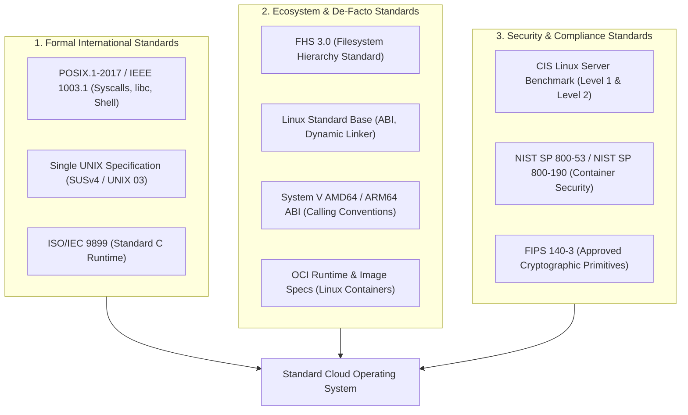
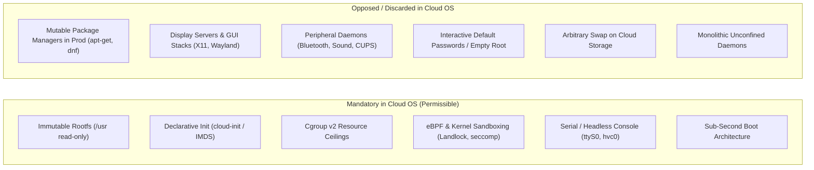
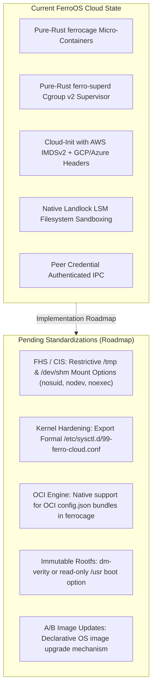

# Standard Operating Systems & Cloud Compliance Specification
### POSIX.1, FHS 3.0, OCI Conformance, CIS Benchmark Hardening, and FerroOS Architecture

This document specifies the formal definition of a **Standard Operating System**, classifies **Specialized Cloud Operating Systems**, details the **mandatory vs. rejected architectural patterns** in modern cloud infrastructure, and outlines the exact **compliance frameworks** adopted by FerroOS Cloud Edition.

---

## 1. What Makes an OS "Standard"?

An operating system is defined as a **standard operating system** when it complies with well-defined, vendor-neutral interface contracts, execution models, and filesystem hierarchies. This standardization ensures that developers can compile, package, and execute applications without modifying application source code or relying on proprietary kernel extensions.

### The Three Tiers of OS Standardization

#### A. Formal International Standards
1. **POSIX.1-2017 / IEEE Std 1003.1**:
   - Defines the standard Application Programming Interface (API) for Unix-like systems: process control (`fork`, `execve`, `waitpid`, `exit`), signal handling (`sigaction`, `sigprocmask`), file operations (`open`, `read`, `write`, `stat`, `fcntl`), inter-process communication (`pipe`, `mkfifo`, POSIX shared memory, message queues), and thread execution (`pthread`).
   - Standardizes core utilities and the POSIX shell grammar (`sh`).
2. **The Open Group Single UNIX Specification (SUSv4 / UNIX 03)**:
   - A formal superset of POSIX. Systems certified as "UNIX" (e.g., macOS, AIX, HP-UX) pass compliance test suites. Modern cloud Linux systems are "POSIX-conformant" rather than formally certified due to licensing constraints.
3. **ISO/IEC 9899 (C Standard Runtime)**:
   - C standard runtime (`glibc`, `musl`, or custom libc) providing memory management (`malloc`, `free`), string manipulation, and standard I/O.

#### B. De-Facto Ecosystem Standards
1. **Filesystem Hierarchy Standard (FHS 3.0)**:
   - Enforces standardized directory roles:
     - `/bin`, `/sbin`, `/usr/bin`: Executable binaries.
     - `/etc`: Host-specific system configuration.
     - `/lib`, `/usr/lib`: Shared object dynamic libraries.
     - `/var`: Variable state (logs, databases, caches).
     - `/tmp`: Ephemeral temporary storage.
     - `/dev`, `/proc`, `/sys`: Virtual kernel interfaces.
     - `/run`: Transient runtime state (sockets, PIDs, cgroups).
2. **System V AMD64 / ARM64 ABI**:
   - Machine-level interface: register calling conventions (`rdi`, `rsi`, `rdx`, `rcx`, `r8`, `r9` on x86-64), 16-byte stack alignment, ELF64 binary format, and standard dynamic linker paths (`/lib64/ld-linux-x86-64.so.2` or musl dynamic loader).
3. **Open Container Initiative (OCI)**:
   - **OCI Runtime Specification**: Execution lifecycle and configuration schema (`config.json`) using Linux namespaces, cgroups, and capabilities.
   - **OCI Image Specification**: Content-addressable layer tarballs, manifests, and image descriptors.

---

## 2. Specialized Cloud Operating Systems: Classification

Cloud infrastructure demands **specialized operating systems** tailored to high density, sub-second spin-up, and automated hypervisor orchestration:

| Class | Industry Examples | Target Workload | Defining Characteristics |
|---|---|---|---|
| **Class A: General Enterprise Server** | RHEL, Rocky Linux, Ubuntu Server, Debian | Stateful databases, legacy enterprise software | Mutable rootfs, package managers (`apt`, `dnf`), full systemd graph, multi-user SSH. |
| **Class B: Container-Optimized OS (Immutable)** | AWS Bottlerocket, Google COS, Flatcar, Talos | Kubernetes worker nodes, container fleets | **Immutable rootfs (`dm-verity` / read-only `/usr`)**, no live package updates, atomic A/B upgrades, API-driven config. |
| **Class C: MicroVM / Serverless OS** | Alpine Linux, Firecracker guest kernels | Functions-as-a-Service (FaaS), transient sandboxes | Kernel + single static PID 1 in RAM, sub-50ms cold boot, < 15MB disk footprint, pure virtio drivers. |
| **Class D: Unikernels / Library OS** | Unikraft, OSv, MirageOS | High-throughput specialized microservices | Single address space, zero privilege rings, no multi-process scheduling. |

---

## 3. Cloud OS Architecture: Allowed vs. Opposed Functionality

A cloud operating system succeeds by **what it deliberately removes**, eliminating the "system tax" on compute hardware.

### Architectural Breakdown

### A. Mandatory Functionality (Allowed & Required)
1. **Automated Cloud Initialization**:
   - Autonomously ingests hypervisor metadata at boot (AWS IMDSv2, GCP Metadata, Azure IMDS, OpenStack config-drive) without human interaction.
   - Configures hostnames, dynamic network routing, SSH authorized keys, and user-data scripts.
2. **Deterministic, Ephemeral, and Immutable Filesystems**:
   - The OS root system (`/usr`, `/bin`, `/lib`) is mounted read-only (`MS_RDONLY`) or cryptographically verified (`dm-verity`).
   - Writable state is restricted to designated ephemeral mounts (`/tmp`, `/var`, `/run`).
3. **Pure Cgroup v2 Isolation & Resource Management**:
   - Strict hierarchical accounting for memory (`memory.max`, `memory.high`), CPU quota (`cpu.max`, `cpu.weight`), and process containment (`pids.max`).
4. **Autonomous Watchdogs & Self-Healing Supervisors**:
   - Automatic restart of faulted services with exponential backoff and health polling without sysadmin intervention.
5. **Headless & Serial Console Telemetry**:
   - Kernel logs and userspace telemetry multiplexed directly to virtual serial devices (`ttyS0`, `hvc0`).

### B. Opposed Functionality (Anti-Patterns to Reject)
1. **Interactive Runtime Package Managers**:
   - Executing `apt-get install` or `yum update` on live production instances causes configuration drift, non-reproducible nodes, and security vulnerabilities. Cloud OS updates must be **atomic image-based deployments**.
2. **Desktop & Peripheral Subsystems**:
   - Complete exclusion of X11, Wayland, Mesa 3D desktop drivers, PulseAudio/PipeWire, Bluetooth (`bluez`), printer spoolers (`cups`), and desktop ACPI handlers.
3. **Default Interactive Passwords**:
   - Production cloud images reject all password-based SSH authentication (`PasswordAuthentication no`). Access is 100% cryptographic SSH key-based or ephemeral token-based.
4. **Unconfined Daemons**:
   - Services must not run as root when non-root users (`nobody`, `www-data`, dedicated accounts) are appropriate.
   - Daemons execute under Landlock LSM, seccomp-bpf, and `PR_SET_NO_NEW_PRIVS`.

---

## 4. Adopted Standards & Compliance Frameworks

FerroOS Cloud Edition implements and tracks compliance against the following formal industry frameworks:

### 1. CIS Linux Server Benchmark (Level 1 & Level 2)
The Center for Internet Security (CIS) Benchmark is the recognized standard for server hardening:
- **Filesystem Configuration**:
  - Separate mount points for `/tmp`, `/var`, `/var/tmp`, `/var/log`.
  - Mandatory `nodev`, `nosuid`, and `noexec` options on `/tmp` and `/dev/shm`.
- **Kernel Sysctl Hardening**:
  - Disable IP packet forwarding: `net.ipv4.ip_forward = 0`.
  - Disable ICMP redirect acceptance: `net.ipv4.conf.all.accept_redirects = 0`.
  - Enable TCP SYN Cookies against DDoS: `net.ipv4.tcp_syncookies = 1`.
  - Enforce Address Space Layout Randomization (ASLR): `kernel.randomize_va_space = 2`.
  - Restrict dmesg access to privileged users: `kernel.dmesg_restrict = 1`.
  - Restrict BPF execution to root: `kernel.unprivileged_bpf_disabled = 1`.
  - Enforce strict reverse-path filtering: `net.ipv4.conf.all.rp_filter = 1`.
- **Access Control & Sandboxing**:
  - Unprivileged user namespace restrictions or explicit containment mapping.
  - Mandatory access control via Landlock LSM / SELinux / AppArmor.

### 2. OCI (Open Container Initiative) Conformance
For micro-container execution in `ferrocage`:
- **Runtime Spec**: Standard execution lifecycle (`create`, `start`, `kill`, `delete`, `state`) and `config.json` ingestion.
- **Image Spec**: Standard OCI layer extraction and sha256 content verification.

### 3. NIST SP 800-190 (Application Container Security Guide)
- Protect host OS against container escape via private namespaces (`mnt`, `pid`, `net`, `ipc`, `uts`, `user`), capability stripping (`CAP_SYS_ADMIN` dropped), read-only host mounts, and seccomp filters.
- Secure local IPC endpoints with peer-credential verification (`SO_PEERCRED`).

### 4. Cloud Provider Certified Guest Specifications
- **AWS**: Nitro Hypervisor compatibility, IMDSv2 token negotiation, ENA network support, and NVMe block storage.
- **GCP**: Guest Environment handshake, `Metadata-Flavor: Google` support, VirtIO-SCSI driver support.
- **Azure**: WALinuxAgent compatibility and Azure Fabric provisioning protocols.

---

## 5. FerroOS Cloud Edition: Gap Analysis & Actionable Roadmap

### Detailed Subsystem Gap Breakdown

| Subsystem | Current Implementation | Standard Requirement | Gap / Action Items |
|---|---|---|---|
| **Container Engine** (`ferrocage`) | Pure-Rust namespace isolation (`mnt`, `pid`, `net`, `ipc`, `uts`), cgroup v2 controller, volume mounts. | OCI Runtime Spec conformance (`runc` compatibility), `config.json` parsing. | Add `--bundle <dir>` execution to ingest standard OCI container bundles directly from Docker/Podman image exports. |
| **Service Supervisor** (`ferro-superd`) | Cgroup v2 memory/CPU/PIDs limits, TOML manifests, peer-credential authenticated IPC socket, auto-restart watchdog. | Systemd service compatibility / CIS service isolation. | Implement standard `/run/systemd/system` socket compatibility or symlinks so existing software expects a standard init socket. |
| **Filesystem Layout** (`ferro-core/disk`) | GUID Partition Table (GPT), ext4 partition formatting, persistent `/etc/fstab` generation. | CIS Benchmark 1.1: nosuid, nodev, noexec on `/tmp` and `/dev/shm`. | Update default `/etc/fstab` generator in `disk.rs` to enforce `nosuid,nodev,noexec` on `/tmp` and `/dev/shm`. |
| **Host Security & Sysctl** | Landlock LSM sandboxing, capability dropping, `PR_SET_NO_NEW_PRIVS`. | CIS Benchmark 3.1 & 3.2: 24 specific kernel networking and memory security sysctls. | Package a hardened `/etc/sysctl.d/99-ferro-cloud.conf` with TCP SYN cookies, ASLR=2, reverse path filtering, and unprivileged BPF disabling. |
| **Cloud Provisioning** (`cloud-init`) | Discovers IMDSv2 token, sets hostname, injects sanitized SSH keys, executes user-data. | Full YAML cloud-config parsing (e.g. `write_files`, `runcmd`, `users`). | Add support for parsing multi-part MIME and `#cloud-config` YAML user-data alongside raw shell scripts. |
| **Storage Immutability** | Read-write ext4 root with Landlock RO path protection. | Class B Container OS standard (read-only `/usr`, ephemeral `/var`). | Implement an immutable overlayfs boot mode (`rootflags=ro` with writable overlay on `/var` and tmpfs on `/tmp`). |

---

## 6. Conclusion & Architectural Invariants

By adhering to these international standards:
1. **Application Developers** receive full POSIX runtime compatibility without proprietary lock-in.
2. **Infrastructure Operators** gain automated cloud-init and OCI container deployment.
3. **Security Auditors** can certify FerroOS against CIS Benchmark Level 2 Server and NIST SP 800-190 compliance.
4. **Cloud Providers** (AWS, GCP, Azure) can execute FerroOS guest images without custom hypervisor workarounds.
