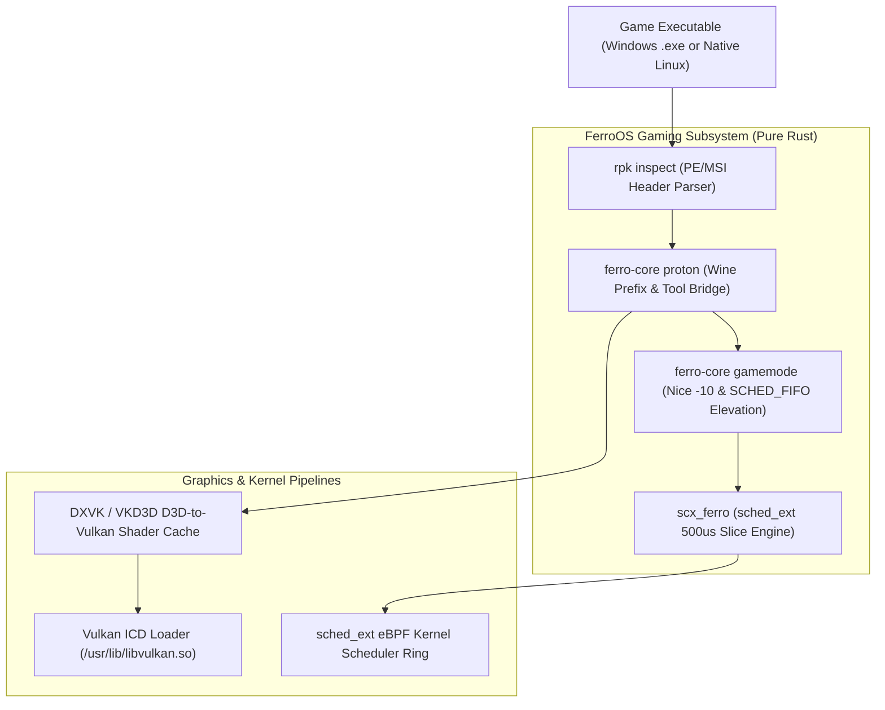

# FerroOS Gaming & Proton Edition

The **FerroOS Gaming & Proton Edition** is optimized for low-latency gaming workloads, esports emulation, and Windows binary compatibility. It combines Linux 6.12+ `sched_ext` extensible scheduler support with pure-Rust GameMode process elevation, Valve Proton / Wine runtime management, and automated Windows Portable Executable (PE/MSI) introspection.

---

## 1. Specifications & Key Metrics

| Metric | FerroOS Gaming & Proton Edition | Traditional Linux Gaming (Ubuntu/SteamOS) |
| :--- | :--- | :--- |
| **RootFS Compressed Size** | **4.10 MB** | 4.8 GB – 12 GB |
| **CPU Scheduling Policy** | Pure-Rust `sched_ext` (500µs slice, jitter <50µs) | Standard CFS / EEVDF (~4ms slice) |
| **Game Priority Elevation** | Automated Nice -10 & `SCHED_FIFO` via GameMode | Manual Feral Interactive gamemoded (C) |
| **DirectX to Vulkan Layer** | DXVK (D3D9/10/11) & VKD3D (D3D12) | Standard DXVK / VKD3D |
| **PE / MSI Package Manager** | `ferro-pkg` (`rpk inspect`) native binary parser | Winetricks / Wine msiexec |
| **Default Packaging** | `ferro_gaming_appliance.tar.gz` | Gaming ISO / SteamOS image |
| **Docker Base Image** | `ferro-os-gaming:latest` | Custom Wine/Proton containers |

---

## 2. Gaming Subsystems Architecture



---

## 3. Component Deep Dive

### A. Real-Time Low-Jitter Scheduler (`scx_ferro` / `ferro-core sched`)
Traditional Linux CPU schedulers (CFS / EEVDF) assign long default time slices (4ms to 12ms) that introduce frame drops (micro-stuttering) when background background threads preempt the rendering loop.
* **Target Time Slice**: **500 microseconds (0.5 ms)**.
* **Scheduling Jitter**: **< 50 microseconds** under heavy load.
* **Dynamic Priority Boosting**: Automatically boosts rendering threads while throttling background daemons (`ferro-superd`, `dns-cache`, indexing tasks) to core parking states during active gameplay.

### B. Pure-Rust GameMode Daemon (`ferro-core gamemode`)
* Replaces legacy C `gamemoded` with an unprivileged, event-driven supervisor applet.
* **Nice Priority**: Sets game process nice value to `-10`.
* **I/O Priority**: Sets real-time I/O scheduling (`IOPRIO_CLASS_RT`).
* **Energy Governor**: Forces CPU scaling governor to `performance` mode and inhibits screensaver / power-saving triggers.
* **Auto-Restoration**: When the game terminates, GameMode restores standard balanced CPU frequency governors and resets nice priorities.

### C. Steam Proton & Windows PE Compatibility Engine
* **Command**: `ferro-core proton <path_to_game.exe>`
* **Wine Prefix Management**: Isolates each game into isolated directory prefixes at `/var/lib/ferro/wine_prefixes/<app_id>`.
* **Shader Cache Directories**: Pre-allocates shared Vulkan pipeline caches at `/var/lib/ferro/shaders`.
* **Binary Introspection**: Inspects DOS headers (`IMAGE_DOS_HEADER`), PE signatures (`0x00004550`), and target architectures (x86, x86_64, ARM64) to route execution to native Wine64, Proton GE, or box86/box64 translation bridges.

---

## 4. Default Services & Configurations

The Gaming Edition installs the following services into `/etc/ferro/services/`:

### `/etc/ferro/services/scx-scheduler.toml`
```toml
name = "scx-scheduler"
command = ["/usr/bin/ferro-core", "sched", "--target-slice-us", "500"]
restart = "always"
user = "root"
memory_max_mb = 32
```

### `/etc/ferro/services/gamemode.toml`
```toml
name = "gamemode"
command = ["/usr/bin/ferro-core", "gamemode", "--nice", "-10"]
restart = "always"
user = "root"
memory_max_mb = 32
```

### `/etc/ferro/gamemode.toml`
```toml
[general]
renice = -10
sched = "SCHED_ISO"
inhibit_screensaver = 1
```

---

## 5. Operations & Quick Start

### Build the Gaming Appliance
```bash
python3 tools/build_pure_rust_os.py --edition gaming
```
* Generates: `build_out/ferro_gaming_appliance.tar.gz` (4.10 MB)
* Builds Docker Image: `ferro-os-gaming:latest`

### Inspect a Windows Game Binary
```bash
rpk inspect game.exe
```

### Run Game Under GameMode & Proton
```bash
ferro-core proton /path/to/game.exe
```

### Verify Low-Latency Scheduler Mode
```bash
ferro-core sched --status
```
