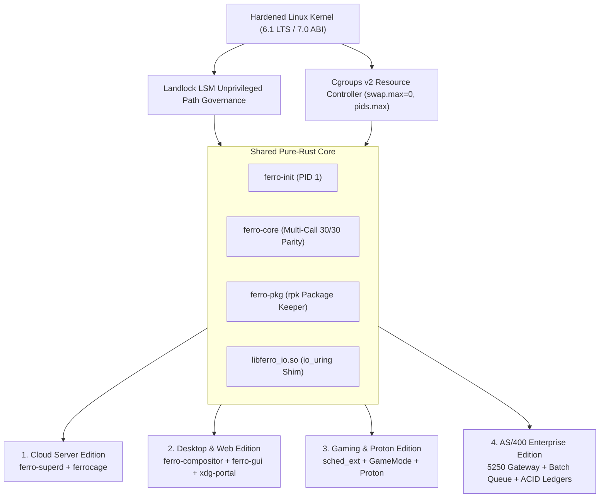

# The Four Connected Editions of FerroOS

FerroOS provides a single, high-performance, memory-safe pure-Rust core that specializes into four distinct operating system profiles, plus a universal master distribution. Each edition shares the identical Linux ABI, standard GNU coreutils parity, unprivileged Landlock LSM sandboxing, and Cgroups v2 resource governance, but is tuned with domain-specific daemons, kernel parameters, and services.

---

## Edition Matrix & Quick Comparison

| Edition | Primary Focus | Target Environments | RootFS Size | Supervisor RSS | Key Distinguishing Technologies | Documentation |
| :--- | :--- | :--- | :--- | :--- | :--- | :--- |
| **Cloud Server** | Micro-Appliance & Cloud VMs | AWS EC2, GCP Compute, Azure VMs, Edge | **3.61 MB** | **< 3 MB** | `ferro-superd`, `ferrocage`, `io_uring` POSIX shim, Cloud-Init | [Read Guide](CLOUD_SERVER.md) |
| **Desktop & Web** | High-Performance Workstation | Laptops, Thin Clients, Remote Workstations | **4.10 MB** | **~15 MB** | `ferro-compositor` (Wayland), `ferro-gui` (/dev/fb0), noVNC port 6080 | [Read Guide](DESKTOP_WEB.md) |
| **Gaming & Proton** | Real-Time Gaming & Emulation | Gaming PCs, Handhelds (Steam Deck), Cloud Gaming | **4.10 MB** | **~12 MB** | `sched_ext` (500µs slice), GameMode (nice -10), Proton runner, DXVK | [Read Guide](GAMING_PROTON.md) |
| **AS/400 Enterprise** | Financial & Batch Processing | Enterprise Mainframes, Banking, Telecom | **3.61 MB** | **~15 MB** | Parallel Batch Queue Worker, 5250 Terminal Gateway, ACID Ledgers | [Read Guide](AS400_ENTERPRISE.md) |
| **Universal Pure-Rust** | Master Distribution | General Purpose, Development, All Profiles | **4.10 MB** | **Dynamic** | All 8 pure-Rust binaries, all 90+ applets, runtime profile switching | [Build Guide](../developer/BUILD_AND_PACKAGING.md) |

---

## Architectural Shared Foundation

Every edition of FerroOS is built upon the same fundamental pillars:

---

## Selecting the Right Edition

* Choose **[Cloud Server](CLOUD_SERVER.md)** if you are deploying microservices, web APIs, or running on budget cloud instances ($12 challenge).
* Choose **[Desktop & Web](DESKTOP_WEB.md)** if you need an interactive graphical desktop with zero X11/C bloat that can be accessed locally via DRM/KMS or remotely via a browser.
* Choose **[Gaming & Proton](GAMING_PROTON.md)** if your workload requires sub-50µs scheduler latency, Windows PE binary execution via Proton, or real-time game prioritization.
* Choose **[AS/400 Enterprise](AS400_ENTERPRISE.md)** if you process batch transactions, manage ACID financial ledgers, or interface with legacy IBM mid-range systems.
* Choose **[Universal Master](../developer/BUILD_AND_PACKAGING.md)** if you are building container images or evaluating the full capabilities of FerroOS in one package.
