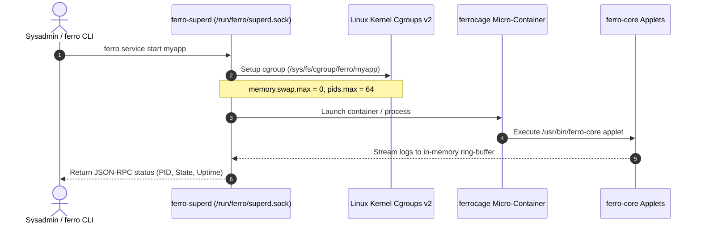

# FerroOS Operations & Userspace Subsystems

FerroOS replaces legacy Linux system management bloat (`systemd`, `dockerd`, `containerd`, and 180+ separate GNU coreutils binaries) with **three focused, pure-Rust userspace daemons**:

1. **[`ferro-superd`](SERVICE_SUPERVISION.md)**: The Cgroups v2 service supervisor and process lifecycle manager.
2. **[`ferrocage`](CONTAINER_RUNTIME.md)**: The sub-2ms pure-Rust micro-containerization runtime.
3. **[`ferro-core`](COREUTILS_AND_PARITY.md)**: The multi-call binary providing 30/30 GNU differential parity, POSIX shell, and embedded servers.

---

## Operations Documentation Index

| Topic | Document | Summary |
| :--- | :--- | :--- |
| **Service Supervision** | [SERVICE_SUPERVISION.md](SERVICE_SUPERVISION.md) | Declarative TOML services, Cgroups v2 quotas (`swap.max=0`, `cpu.max`), IPC socket `/run/ferro/superd.sock`, `ferro service` commands. |
| **Micro-Containers** | [CONTAINER_RUNTIME.md](CONTAINER_RUNTIME.md) | `ferrocage` engine, Linux namespaces (PID, mount, net, IPC, UTS), sub-2ms startup, volume mounts, `ferrocage run|ps|stop|rm`. |
| **GNU Coreutils Parity** | [COREUTILS_AND_PARITY.md](COREUTILS_AND_PARITY.md) | 30/30 head-to-head differential parity matrix vs Ubuntu GNU coreutils, multi-call symlink mechanics, POSIX shell. |

---

## Unified Subsystem Interaction Model

