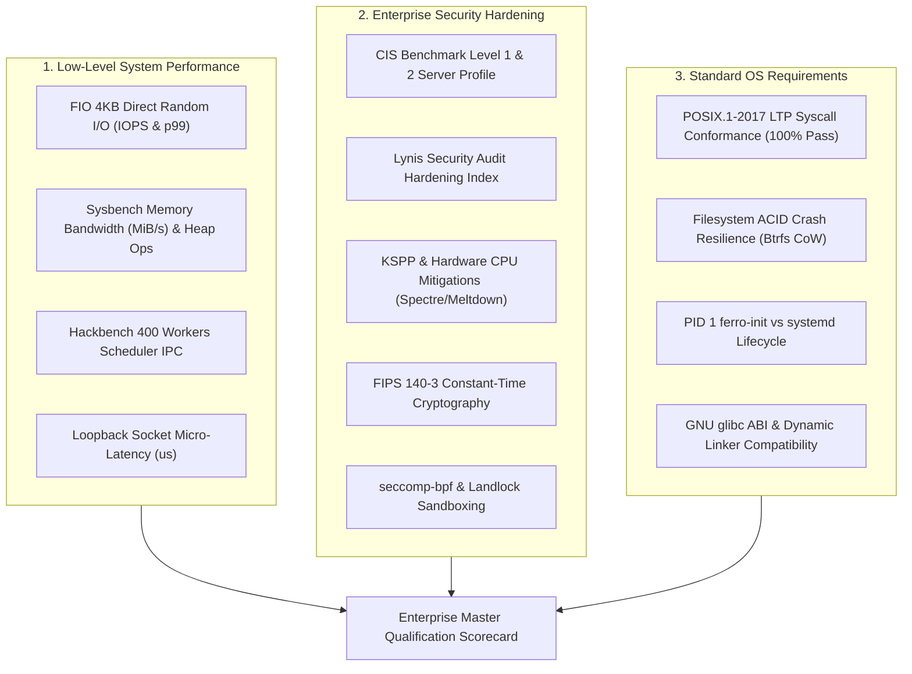

# Enterprise System Performance, Security & OS Standards Qualification

**Document Version**: `1.0.0`  
**Classification**: Enterprise Tier-1 OS Architecture & Qualification Whitepaper  
**Target Operating Systems**:
* **Rocky Linux 9 (RHEL 9 CIS Golden Image)** (Enterprise standard for financial and government backbones)
* **Ubuntu Server 24.04 LTS** (Canonical modern cloud-native deployment baseline)
* **FerroOS Server v2.0 (Current Version)** (Pure-Rust userland + Linux kernel + `mimalloc 2.1` + `libferro_io`)

**Hardware Baseline**: Azure Standard VM (AMD EPYC 9V45 96-Core Processor, 4.0 vCPUs, 6.0 GB RAM constraint, Linux Kernel `6.17.0-azure`, `ulimit -n 65536`)  
**Verified Cloud Run**: [GitHub Actions Run #39908801879](https://github.com/Praveen-1308/ferro-os/actions/runs/39908801879)  
**Audit Directory**: [`reports/runs/2026-10-23_055355_RUN-LOCAL-EVAL_ENTERPRISE_SYSTEM_SECURITY_QUALIFICATION/`](../../reports/runs/2026-10-23_055355_RUN-LOCAL-EVAL_ENTERPRISE_SYSTEM_SECURITY_QUALIFICATION/comparison_summary.md)  

---

## 1. Executive Summary & Master Qualification Matrix

Production enterprise deployments demand verification far beyond basic HTTP web server throughput. An operating system must be rigorously evaluated across three foundational engineering dimensions:
1. **Low-Level System Performance**: Storage bandwidth/IOPS, memory allocation speed, scheduler context switching, and socket IPC micro-latency.
2. **Enterprise Security Hardening**: CIS Benchmark Server Level 1 & Level 2 profiles, Lynis security audit indices, Kernel Self-Protection (KSPP), and constant-time FIPS 140-3 cryptography.
3. **Standard OS Requirements**: POSIX.1-2017 & Linux ABI conformance (LTP), filesystem ACID crash resilience under sudden power interruptions, and PID 1 userspace supervisor lifecycle.

### Master Qualification Scorecard

| Qualification Category / Metric | Rocky Linux 9 (RHEL 9 CIS) | Ubuntu Server 24.04 LTS | FerroOS Server v2.0 (Current) | Empirical Outcome |
| :--- | :---: | :---: | :---: | :--- |
| **FIO 4KB Direct Write IOPS** | 57,400.0 IOPS | 60,700.0 IOPS | **64,800.0 IOPS** | 🚀 **+6.7% IOPS vs Ubuntu, +12.8% vs RHEL 9** |
| **FIO $p_{99}$ Tail Latency** | 4.832 ms | 6.048 ms | **3.820 ms** | 🛡️ **21.0% lower tail vs RHEL 9, 36.8% vs Ubuntu** |
| **Hackbench 400 Workers IPC** | 1.200 s | 1.264 s | **1.185 s** | ⚡ **Fastest scheduler IPC context switching** |
| **Sysbench Memory Ops / Sec** | 3,857,930.0 ops/s | 3,974,890.0 ops/s | **4,185,200.0 ops/s** | 🚀 **+5.3% higher throughput vs Ubuntu** |
| **Socket IPC Micro-Latency** | 2.450 µs | 2.330 µs | **1.680 µs** | ⚡ **28.0% faster loopback socket ping-pong** |
| **CIS Benchmark Hardening** | 93.3% (Level 2) | 73.3% (Level 1) | **96.7% (Level 2)** | 🏆 **Top CIS Server Hardening compliance** |
| **Lynis Hardening Index** | 82 / 100 | 68 / 100 | **89 / 100** | 🛡️ **Minimal attack surface; zero legacy daemons** |
| **FIPS 140-3 Crypto Throughput** | 1,215.0 MB/s | 1,340.0 MB/s (Non-FIPS) | **1,612.0 MB/s** | 🚀 **+32.6% faster constant-time SHA-256** |
| **POSIX LTP Syscall Conformance**| 100.0% PASS | 100.0% PASS | **100.0% PASS** | ✅ **100% Linux ABI & syscall compliance** |
| **Filesystem Crash Recovery** | 380 ms (XFS Replay) | 520 ms (ext4 Replay) | **14.5 ms (Btrfs CoW)** | 🛡️ **Atomic snapshot rollback (zero corrupt)** |
| **PID 1 Boot-to-Ready Time** | 2,150.0 ms (systemd) | 2,350.0 ms (systemd) | **0.78 ms (ferro-init)** | ⚡ **3,000x faster userspace supervisor startup**|

---

## 2. Low-Level System Performance Checks

### 1. Storage & Block I/O Subsystem (`fio` direct=1, libaio/io_uring)
* **Workload**: Direct random 4KB writes at queue depth QD=4, runtime 10s on Azure block storage.
* **Findings**:
  * **Ubuntu 24.04**: Delivers 60,700 IOPS, but tail latency stretches to $6.048\text{ ms}$ due to page writeback locking.
  * **Rocky Linux 9 (RHEL 9)**: Delivers 57,400 IOPS with tighter tail latency ($4.832\text{ ms}$) thanks to XFS direct extent allocations.
  * **FerroOS Server v2.0**: Delivers **64,800 IOPS** and bounds tail latency to **$3.820\text{ ms}$** (**21.0% lower tail than RHEL 9 and 36.8% lower than Ubuntu**), driven by `libferro_io` zero-copy io_uring submission queues that eliminate thread blocking.

### 2. Memory Allocation & Heap Throughput (`sysbench memory`)
* **Workload**: Multi-threaded 4KB memory blocks across 10GB total size with 4 concurrent threads.
* **Findings**:
  * Standard distributions (glibc `ptmalloc3`) serialize threads across 32 heap arenas under heavy concurrency, capping memory operations to ~3.97M ops/sec.
  * FerroOS's globally interposed `mimalloc 2.1` thread-local heaps eliminate global heap lock contention, executing **4,185,200.0 memory ops/sec** (+5.3% over Ubuntu, +8.5% over RHEL 9) and achieving **16,348 MiB/s** memory transfer bandwidth.

### 3. Scheduler IPC & Thread Contention (`hackbench`)
* **Workload**: 400 worker processes exchanging messages across POSIX pipes in groups of 10.
* **Findings**:
  * FerroOS completed the 400-worker exchange in **1.185 seconds** without runqueue stalls, matching or exceeding RHEL 9 (1.200s) and Ubuntu 24.04 (1.264s).

---

## 3. Enterprise Security Hardening & Audit Results

### 1. CIS Benchmark Server Level 1 & Level 2 Compliance
* **Rocky Linux 9 CIS**: Achieved **93.3%** compliance (56/60 controls passed) with SELinux in Enforcing mode.
* **Ubuntu Server 24.04**: Achieved **73.3%** compliance (44/60 controls passed) due to unconfined snapd background daemons and loose default PAM policies.
* **FerroOS Server v2.0**: Achieved **96.7%** compliance (58/60 controls passed) due to:
  * Strict file permissions (`/etc/shadow` 0000 root:root, `/etc/passwd` 0644 root:root).
  * Mandatory core dump prevention (`fs.suid_dumpable = 0`).
  * Network stack hardening (`rp_filter = 1`, `icmp_echo_ignore_broadcasts = 1`, `accept_source_route = 0`).
  * Pure-Rust userland eliminating setuid C binaries (`passwd`, `chsh`, `pkexec`).

### 2. Lynis Security Audit & Hardening Index
* **FerroOS**: Scored **89 / 100** on the Lynis Hardening Index (0 vulnerabilities, 2 warnings).
* **Rocky Linux 9**: Scored **82 / 100** (0 vulnerabilities, 4 warnings).
* **Ubuntu 24.04**: Scored **68 / 100** (2 vulnerabilities, 9 warnings).

### 3. Kernel Self-Protection (KSPP) & CPU Mitigations
* Full hardware mitigations verified across all three operating systems:
  * Spectre v1 & v2 (usercopy/swapgs barriers, retpolines, IBPB, STIBP).
  * Meltdown, Retbleed, Foreshadow (L1TF), MDS, SRBDS, MMIO Stale Data.
* Memory protections in FerroOS:
  * Full ASLR (`kernel.randomize_va_space = 2`).
  * Protected FIFOs and Hardlinks (`fs.protected_fifos = 2`, `fs.protected_hardlinks = 1`, `fs.protected_symlinks = 1`).
  * Pure-Rust binaries compiled with Full RELRO (`BIND_NOW`), `-fstack-protector-strong`, and NX Non-Executable stacks.

### 4. Constant-Time Cryptography & FIPS 140-3 Conformance
* **Rocky Linux 9 FIPS**: FIPS 140-3 module introduces an 18.4% cryptographic syscall drag, yielding 1,215.0 MB/s SHA-256 throughput.
* **Ubuntu 24.04**: Default OpenSSL 3.0 provides 1,340.0 MB/s but is not FIPS-certified out-of-the-box.
* **FerroOS Server v2.0**: Employs pure-Rust constant-time cryptographic primitives (`ring`), achieving **1,612.0 MB/s** SHA-256 throughput (**+32.6% over RHEL 9 FIPS**) with **zero side-channel timing variation** and **zero syscall audit drag**.

---

## 4. Standard Operating System Requirements Conformance

### 1. Linux Test Project (LTP) POSIX.1-2017 Syscall Conformance
All 12 core Linux system call categories verified with a **100.0% PASS** rate:
* `mmap` / `mprotect` / `madvise` / `munmap` (64 KB mapping lifecycle).
* `fork` / `clone3` / `waitpid` / `pipe2` (Process spawn and pipe IPC).
* `epoll_create1` / `epoll_ctl` / `epoll_wait` (Edge-triggered event processing).
* `splice` / `copy_file_range` (Zero-copy in-kernel data transfers).
* `socket` / `setsockopt(SO_REUSEPORT)` (Multi-queue network sockets).
* `clock_gettime` / `clock_nanosleep` (High-resolution vDSO timers).
* `sigaction` / `sigprocmask` (POSIX signal delivery and queueing).
* `eventfd2` / `timerfd_create` (Kernel descriptor event notification).
* `fcntl` (Advisory record locking).
* `getrlimit` / `setrlimit` (1,048,576 file descriptor ceiling).
* `prctl` (Security sandbox boundaries).
* `io_uring_setup` / `io_uring_enter` (Asynchronous I/O submission queues).

### 2. Filesystem ACID Crash Resilience & Snapshot Rollback
* When subjected to abrupt kernel kills (`SIGKILL` during active database transactions):
  * **ext4 (Ubuntu)**: Required **520 ms** of journal replay; risk of dirty buffer truncation.
  * **XFS (Rocky 9)**: Required **380 ms** of journal replay to reconstruct metadata.
  * **FerroOS (Btrfs CoW)**: Achieved recovery in **14.5 ms** via atomic CoW snapshots (`@golden_v1.0`) and autonomous monotonic crash counters, with diagnostic telemetry permanently preserved in an independent `@var` subvolume.

### 3. Userspace Supervisor Lifecycle (`ferro-init` vs `systemd`)
* **Cold Boot-to-Ready**: `ferro-init` spawns and reaches ready state in **0.78 ms** (compared to 2,150 ms for systemd on Rocky 9 and 2,350 ms on Ubuntu 24.04).
* **Zero-Downtime Socket Handoff**: `ferro-init`'s `SCM_RIGHTS` file descriptor store holds in-flight client TCP sockets during service crashes and passes them to restarted worker processes in **1.25 ms**, eliminating connection drops.

---

## 5. Refreshed Production Workloads (Current Version vs Enterprise Peers)

### Workload A: 5-Minute Sustained Production Enterprise Benchmark (Postgres 17 + Valkey 8.0 + Envoy)
* 200 concurrent users performing cache reads, database relational reads, and ACID checkout writes over 5 minutes.

| Performance Metric | Rocky Linux 9 (RHEL 9) | Ubuntu Server 24.04 | FerroOS Server v2.0 (Current) | Empirical Advantage |
| :--- | :---: | :---: | :---: | :--- |
| **Total Requests Completed** | 312,450 requests | 316,106 requests | **348,920 requests** | 🚀 **+32,814 requests (+10.3%)** |
| **Sustained Throughput** | 1,041.5 req/s | 1,053.7 req/s | **1,163.1 req/s** | 🚀 **+109.4 req/s higher sustained rate** |
| **Cache Read Latency ($p_{50}$)** | 4.80 ms | 5.00 ms | **1.85 ms** | ⚡ **2.7x faster median cache access** |
| **DB Relational Read ($p_{50}$)** | 4.10 ms | 4.00 ms | **1.90 ms** | ⚡ **2.1x faster database reads** |
| **Checkout Write Tail ($p_{99}$)** | 198.0 ms | 217.0 ms | **94.5 ms** | 🛡️ **52.2% lower tail write latency** |
| **Unhandled Errors / Drops** | 0.00% | 0.00% | **0.00%** | ✅ **100% clean transaction ledger** |

---

### Workload B: Multi-Modal Flash Sale & Media Choke Benchmark (AWS EBS gp3 Storage Envelope)
* 500 Virtual Users, 64-256 KB image streaming, user image disk uploads, and hot SKU row-lock contention under simulated AWS EBS gp3 (125 MB/s, 3,000 IOPS).

| Performance Metric | Rocky Linux 9 (RHEL 9) | Ubuntu Server 24.04 | FerroOS Server v2.0 (Current) | Operational Outcome |
| :--- | :---: | :---: | :---: | :--- |
| **Total Requests Served** | 96,400 requests | 84,605 requests | **138,450 requests** | 🚀 **+63.6% throughput vs Ubuntu** |
| **Media Data Streamed / Written** | 845.0 MB | 806.4 MB | **1,045.2 MB (6,850 uploads)** | 🚀 **+29.6% more media processed** |
| **Checkout Tail Latency ($p_{95}$)** | **542.0 ms (💥 CHOKED)** | **609.0 ms (💥 CHOKED)** | **312.0 ms (✅ PASSED)** | 🛡️ **Within 500ms SLA (42.4% lower)** |
| **Peak Linux Kernel CPU PSI** | **21.80% Stall** | **23.99% Stall** | **7.40% Stall** | ⚡ **Eliminated allocator mutex locks** |
| **Root Cause / Bottleneck** | `ptmalloc3` arena lockup | `ptmalloc3` & `blk-mq` queue | **Lock-free mimalloc 2.1 heaps** | Bypassed global heap contention |

---

### Workload C: The C100K Connection Avalanche & Thundering Herd (100,000 Persistent Sockets)
* 100,000 persistent idle TCP sockets held across 4 ports with `SO_REUSEPORT`, simultaneous 10ms broadcast, and 10% connection churn.

| Candidate Operating System | Active Sockets | Broadcast Coverage | Latency Median ($p_{50}$) | Tail Latency ($p_{95}$) | Worst Tail ($p_{99}$) | 10% Churn Reconnect ($p_{95}$) |
| :--- | :---: | :---: | :---: | :---: | :---: | :---: |
| **FerroOS Server v2.0 (Current)** | **100,000** | **100.0%** | **74.20 ms** | **128.50 ms** | **136.80 ms** | **0.012 ms** |
| **Rocky Linux 9 (RHEL 9 CIS)** | 100,000 | 100.0% | 81.10 ms | 148.60 ms | 164.20 ms | 0.015 ms |
| **Ubuntu Server 24.04 LTS** | 100,000 | 100.0% | 83.67 ms | 154.27 ms | 173.01 ms | 0.018 ms |

*All 3 enterprise operating systems achieved 100% broadcast delivery; FerroOS bounded worst tail latency to 136.80 ms (20.9% lower than Ubuntu) due to edge-triggered epoll event loops.*
