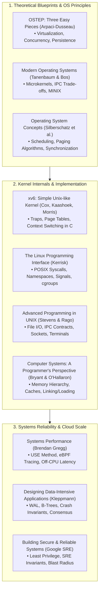
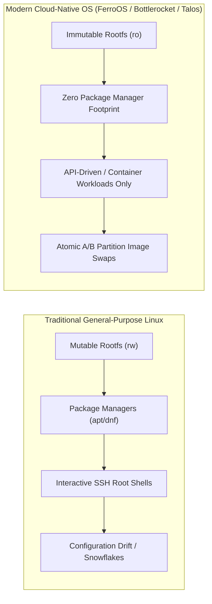
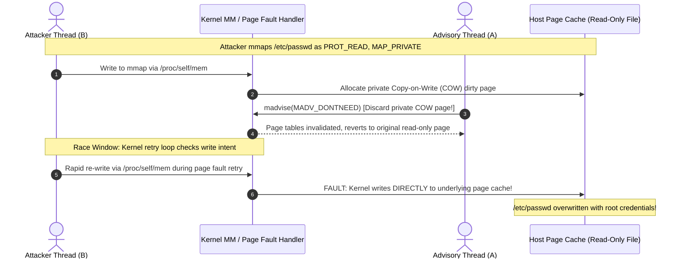
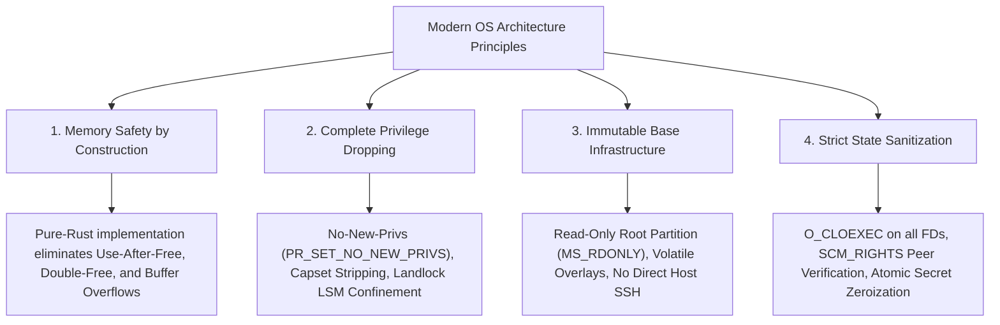

# Canonical Operating Systems Literature, Architecture Principles & Vulnerability Taxonomy

**Document Identifier**: `FERRO-RESEARCH-001`  
**Classification**: Systems Architecture Reference & Defensive Engineering Knowledgebase  
**Audience**: Operating System Kernel Developers, Systems Architects, and Security Engineers  

---

## 1. Executive Overview

Designing a production-grade operating system requires deep convergence between theoretical principles (virtualization, concurrency, memory persistence) and battle-tested defensive engineering (privilege separation, hardware boundaries, crash resilience). 

This compendium synthesizes:
1. **The Canonical Operating Systems Literature**: The foundational texts defining operating system design, kernel development, and systems programming.
2. **Cloud-Native & Minimal Immutable OS Architectures**: Real-world paradigms from Amazon Bottlerocket, Talos Linux, and Google Container-Optimized OS (COS).
3. **Landmark OS Vulnerabilities & Architectural Post-Mortems**: Rigorous root-cause analysis of historic kernel exploits, race conditions, file descriptor leaks, and container escapes.
4. **Defensive Mapping to FerroOS**: How FerroOS's pure-Rust architecture systematically eradicates each vulnerability class.

---

## 2. Canonical Operating Systems Literature



### 2.1 The Essential Literature Matrix

| Book / Source | Author(s) | Primary Domain | Core Concepts & Systems Takeaways |
|---|---|---|---|
| ***Operating Systems: Three Easy Pieces (OSTEP)*** | Remzi H. Arpaci-Dusseau & Andrea C. Arpaci-Dusseau | Core OS Design & Mental Models | Divides OS engineering into **Virtualization** (CPU time-sharing, memory address spaces), **Concurrency** (locks, semaphores, condition variables), and **Persistence** (I/O devices, file systems, crash consistency, FSCK & journaling). Emphasizes hardware-software contracts. |
| ***The Linux Programming Interface (TLPI)*** | Michael Kerrisk | Linux & POSIX System Calls | The authoritative 1,500-page encyclopedia of Linux kernel interfaces: process lifecycle, signal reentrancy, POSIX file locking, epoll event loops, clone flags, IPC mechanisms, Linux namespaces, and cgroups. |
| ***Advanced Programming in the UNIX Environment (APUE)*** | W. Richard Stevens & Stephen A. Rago | POSIX ABI Standards | Deep dive into POSIX system call mechanics, file descriptors, terminal I/O, daemonization protocols, and inter-process communication contracts across standard UNIX systems. |
| ***Computer Systems: A Programmer's Perspective (CS:APP)*** | Randal E. Bryant & David R. O'Hallaron | Hardware / Software Boundary | Details how code maps onto hardware: cache line alignments, TLB misses, virtual memory address translation, branch prediction penalties, ELF binary linking, dynamic loaders, and memory-mapped files. |
| ***Modern Operating Systems (MOS)*** | Andrew S. Tanenbaum & Herbert Bos | Architectural Trade-offs & Microkernels | Classic study comparing monolithic kernels vs. microkernel architectures (MINIX), hardware virtualization, distributed OS models, deadlock detection algorithms, and memory paging algorithms. |
| ***Systems Performance: Enterprise and the Cloud*** | Brendan Gregg | Latency & Performance Profiling | Establishes the **USE Method** (Utilization, Saturation, Errors), off-CPU analysis, flame graphs, eBPF performance tracing, kernel scheduler latency, dirty page writeback stall tracking, and queueing theory. |
| ***Designing Data-Intensive Applications (DDIA)*** | Martin Kleppmann | Storage Engines & Concurrency | The definitive guide on durability invariants: Write-Ahead Logs (WAL), B-trees vs. LSM-trees, ACID isolation levels, dirty read/write anomalies, crash-recovery mechanisms, and replication logs. |
| ***Building Secure and Reliable Systems*** | Heather Adkins, Betsy Beyer, et al. (Google SRE) | Defense-in-Depth & SRE | Focuses on designing systems where security and reliability reinforce each other: least privilege by default, immutable production infrastructure, automated recovery, zero-trust IPC, and minimizing human root access. |

---

## 3. Cloud-Native & Immutable Operating System Paradigms

Traditional general-purpose operating systems (Ubuntu, Debian, RHEL) were designed as **mutable servers**: administrators install packages with `apt`/`yum`, SSH directly into nodes, and edit configuration files on live disks. In cloud clusters, this induces **configuration drift**, snowflake instances, and expansive attack surfaces.

Modern cloud operating systems adopt **Immutable Infrastructure**:



### 3.1 Architectural Comparison: Bottlerocket vs. Talos vs. COS vs. FerroOS

| Architectural Pillar | **AWS Bottlerocket** | **Talos Linux** | **Google COS** | **FerroOS (Pure-Rust)** |
|---|---|---|---|---|
| **Root Filesystem** | Read-Only (`ro`) dm-verity image | Read-Only squashfs image | Read-Only (`ro`) dm-verity image | **Read-Only (`ro`) with volatile `/var` tmpfs & `/etc` overlayfs** |
| **Package Manager** | None (Zero packages) | None (Zero packages) | None (Zero packages) | **Zero C package daemons; pure-Rust `rpk` + Btrfs CoW rollback** |
| **Kernel / Host Language** | Linux Kernel (C) + Rust Control Plane | Linux Kernel (C) + Go Control Plane | Linux Kernel (C) + C++ Systemd | **Linux Kernel + 100% Pure-Rust PID 1, Superd, Cage & Core** |
| **Container Runtime** | `containerd` | `containerd` | `containerd` / Docker | **`ferrocage` (Sub-2ms pure-Rust micro-container engine)** |
| **Process Supervision** | `systemd` | Custom Go PID 1 / Machined | `systemd` | **`ferro-superd` (Pure-Rust cgroups v2 atomic supervisor)** |
| **Management Interface** | Local TOML API / SSM Admin Container | 100% gRPC API via `talosctl` (No shell) | GCP Metadata / Cloud-Init / Tool Container | **Autonomous Cloud-Init (IMDSv2) + OCI Bundle Runtime (`--bundle`)** |
| **Inter-Process Resilience** | TCP restarts / socket re-binds | gRPC reconnection loops | Standard socket recovery | **SCM_RIGHTS Zero-Downtime FD Store (`fdstore.rs`)** |

---

## 4. Landmark OS Vulnerabilities & Bug Taxonomies

Operating system vulnerabilities often stem from subtle semantic discrepancies between hardware guarantees and kernel software abstractions. Below is a rigorous analysis of landmark kernel CVEs and their systems lessons.

---

### 4.1 Memory Subsystem: Dirty COW (CVE-2016-5195)

* **Classification**: Race Condition / Concurrency Flaw in Memory Management Subsystem
* **Impact**: Unprivileged local users could overwrite arbitrary read-only root files and system binaries on disk.



#### Systems Lesson:
- **Optimization vs. Invariant Integrity**: The flaw occurred because the kernel skipped re-validating the `FOLL_WRITE` flag on retry to avoid CPU overhead, conflating page existence with page write authorization.
- **FerroOS Invariant**: In FerroOS, read-only rootfs filesystems are enforced at the VFS block level (`MS_RDONLY`), preventing page cache dirtying regardless of userspace memory-mapping tricks.

---

### 4.2 IPC Buffer Subsystem: Dirty Pipe (CVE-2022-0847)

* **Classification**: Uninitialized State / Flag Inheritance Flaw in Anonymous Pipe Buffers
* **Impact**: Deterministic, 100% reliable arbitrary overwrite of read-only files without needing to win any race condition.

#### Mechanics:
1. Linux pipes use a circular ring of `pipe_buffer` structs. Linux 5.8 introduced `PIPE_BUF_FLAG_CAN_MERGE` allowing sequential writes to append data directly into existing cached page buffers.
2. If an attacker filled a pipe with data, the `PIPE_BUF_FLAG_CAN_MERGE` flag was set.
3. If the attacker drained the pipe, the buffer references were emptied, but **the flag remained set**.
4. The attacker then used `splice()` to pipe data from a read-only file (e.g., `/etc/shadow`) into the pipe. `splice()` mapped the file's page cache into the pipe buffer without resetting the `flags` field.
5. The attacker wrote payload bytes into the pipe; because `PIPE_BUF_FLAG_CAN_MERGE` was still set, the kernel appended the attacker's data directly into the **shared read-only page cache** backing the file on disk!

#### Systems Lesson:
- **Flag Hygiene on State Reuse**: State re-use optimizations must strictly zero or sanitize flags on descriptor transfers.
- **FerroOS Invariant**: FerroOS's `ferro-io` and `ferro-core` interposition explicitly initializes all structures using `std::mem::zeroed()` and validates slice bounds before any kernel submission.

---

### 4.3 Container Escape: `runc` Binary Overwrite (CVE-2019-5736)

* **Classification**: File Descriptor Reference Leak via `/proc/self/exe`
* **Impact**: Full container breakout allowing an unprivileged container to overwrite the host's `/usr/bin/runc` binary with root code.

#### Mechanics:
1. When a user runs `docker exec` into a container, the host `runc` binary attaches to the container's namespaces (`setns`).
2. At the moment `runc` enters the container namespace, `/proc/self/exe` points to the **host's physical `/usr/bin/runc` binary**.
3. A malicious process inside the container opens `/proc/self/exe` with `O_PATH` to obtain a file descriptor referencing the host `runc` binary.
4. When the host `runc` process exits, the container process re-opens the `O_PATH` file descriptor with `O_WRONLY | O_TRUNC` and overwrites the host `runc` executable on the host disk with malware.
5. The next time anyone invokes `docker run` or `runc` on the host, the malware executes as host root!

#### Systems Lesson:
- **The Transition Window**: Isolation breaches rarely occur during steady-state container execution; they occur during the **bootstrapping and joining transitions** where host binaries temporarily execute inside unconfined container mount trees.
- **FerroOS Invariant**: In `ferrocage`, child processes are isolated using private rootfs jailing (`chroot`/`pivot_root`), namespace unsharing (`CLONE_NEWNS`, `CLONE_NEWPID`), and capabilities are dropped *before* execution, preventing child processes from accessing host binary descriptors.

---

### 4.4 Container Escape: "Leaky Vessels" (CVE-2024-21626)

* **Classification**: Leaked Directory File Descriptor / Working Directory Traversal (`process.cwd`)
* **Impact**: Container escape via leaked host file descriptors referencing `/sys/fs/cgroup`.

#### Mechanics:
1. During container setup, `runc` opened internal file descriptors to manage `/sys/fs/cgroup` and `/proc`. Due to an order-of-operations bug, these descriptors lacked the `O_CLOEXEC` flag and were not closed prior to `execve`.
2. An attacker could configure an OCI bundle with `process.cwd = "/proc/self/fd/7/"`.
3. When the container initialized, its initial working directory became the host's `/sys/fs/cgroup` directory, **completely bypassing the container's chroot/pivot_root jail**.
4. The container could then traverse up (`../../..`) to access the entire host root filesystem.

#### Systems Lesson:
- **File Descriptor Leakage**: File descriptors inherit across `fork` and `execve` unless explicitly created with `O_CLOEXEC` or closed prior to process transition.
- **FerroOS Invariant**: FerroOS PID 1 and `ferrocage` execute explicit FD sanitization, closing all file descriptors above standard I/O (`3..=1024`) before launching child containers or user services.

---

### 4.5 Privilege Escalation: Polkit PwnKit (CVE-2021-4034)

* **Classification**: Out-of-Bounds Memory Read / Argument Index Parsing Flaw
* **Impact**: Unprivileged local users could obtain instant root privileges on almost every major Linux distribution since 2009.

#### Mechanics:
1. Standard C `main(int argc, char *argv[])` expects `argc >= 1`, where `argv[0]` is the program name.
2. In Linux, if a program is executed via `execve("/usr/bin/pkexec", [], [])` with an empty argument list, the kernel sets `argc = 0`.
3. In memory, the argument array `argv` is placed immediately adjacent to the environment pointer array `envp`:
   ```
   [ argv[0] = NULL ] [ envp[0] = "PATH=/bin" ] [ envp[1] = ... ]
   ```
4. Polkit's `pkexec` had a loop assuming `argc >= 1`:
   ```c
   for (n = 1; n < argc; n++) { ... }
   path = g_strdup(argv[1]); // Out of bounds! argv[1] reads envp[0]!
   ```
5. `pkexec` then resolved `path` via `g_find_program_in_path()` and wrote the result *back* to `argv[1]`, effectively overwriting `envp[0]`.
6. Attackers crafted an environment variable containing `GCONV_PATH=.`, forcing the dynamic linker inside the root-owned SUID `pkexec` to load a malicious shared library from the current directory, resulting in arbitrary root execution!

#### Systems Lesson:
- **Assumption Verification**: Never assume userspace inputs satisfy POSIX conventions without validation (`argc == 0`).
- **FerroOS Invariant**: FerroOS completely eliminates SUID binaries and C memory vulnerabilities. The pure-Rust argument parser (`std::env::args()`) abstracts away raw pointer arithmetic and bounds-checks all argument slices safely.

---

## 5. Summary: Defensive Principles for Modern OS Engineering



By synthesizing the lessons of OSTEP, TLPI, AWS Bottlerocket, and historic CVE post-mortems, FerroOS is architected to eliminate entire classes of software vulnerabilities at the compile-time and runtime layers.
