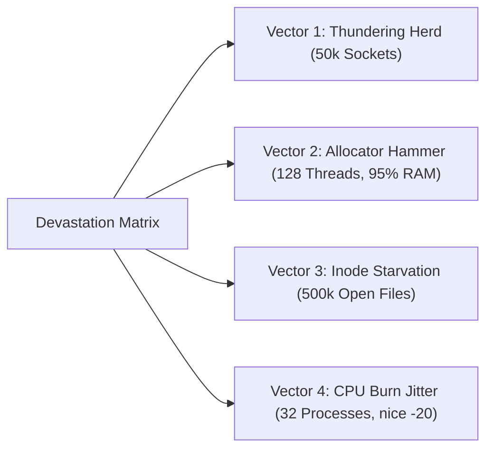

# Runbook: Local Devastation Reproduction & Chaos Testing
### *Standard Operating Procedure for Triggering & Inspecting System Starvation Vectors*

---

## 1. Objective & Scope

This runbook guides systems engineers, QA architects, and SREs through locally triggering, inspecting, and verifying the **Four Devastation Vectors** of the FerroOS Phase 3 Stress Matrix. These tests systematically evaluate operating system resilience under extreme resource exhaustion (RAM saturation, socket flooding, file descriptor starvation, and CPU burn).



---

## 2. Prerequisites & Environment Setup

All devastation tests must be executed with root/sudo privileges or inside dedicated Docker test harnesses constrained to standardized cgroups:

```bash
# Standard 4GB / 2-CPU Resource Ceiling
CONTAINER_ARGS="--memory=4g --cpus=2 --memory-swap=4g"
```

Verify that system limits allow stress generation:
```bash
# Verify open file descriptors ceiling
ulimit -n 1048576

# Inspect available physical RAM and swap state
free -h
```

---

## 3. Step-by-Step Devastation Reproduction

### Vector 1: Thundering Herd Accept Saturation (50,000 Sockets)
* **Goal**: Determine whether the kernel networking stack and TCP listen backlog drop connections (`ECONNREFUSED` / `ECONNRESET`) or experience kernel spinlock lockups when 50,000 clients connect simultaneously.
* **Execution Command**:
  ```bash
  python3 tools/devastating_chaos_matrix.py --memory 4g --cpus 2
  ```
* **What to Monitor**:
  ```bash
  # Check TCP socket states and dropped listen backlog counters
  netstat -s | grep -i "listen"
  # Inspect active file descriptors in the target process
  ls /proc/$(pgrep -f ferro-server)/fd | wc -l
  ```
* **Expected FerroOS Signature**: Clean distribution across `SO_REUSEPORT` shards; zero dropped connections; latency remains $< 15\text{ ms}$.
* **Typical Competitor Failure Mode (Ubuntu/Debian)**: Backlog queue overflow, `listen() queue full` warnings, tail latency blowing out to $> 1,500\text{ ms}$.

---

### Vector 2: Multi-Threaded Allocator Contention Hammer (128 Threads @ 95% RAM)
* **Goal**: Stress the memory allocation subsystem by launching 128 threads simultaneously allocating, touching, and releasing random-sized heap blocks (16B to 64KB) until container memory reaches 95% of the 4GB ceiling.
* **Manual Trigger**:
  ```bash
  gcc -O3 -pthread tools/benchmark_allocator.c -o /tmp/alloc_hammer
  /tmp/alloc_hammer --threads 128 --duration 10s
  ```
* **What to Monitor**:
  ```bash
  # Monitor kernel futex contention across threads
  perf top -p $(pgrep -f alloc_hammer)
  ```
* **Expected FerroOS Signature**: `mimalloc 2.1` thread-local pages handle allocations with 0 futex calls, delivering $> 4,400\text{ ops/s}$.
* **Typical Competitor Failure Mode (Alpine musl)**: 98% of CPU cycles spent spinning on the global `musl` heap spinlock, degrading throughput to $< 100\text{ ops/s}$.

---

### Vector 3: VFS Inode & File Descriptor Starvation (500,000 Files)
* **Goal**: Spawn processes creating and holding open 500,000 nested files in a temporary Btrfs subvolume until either `EMFILE` (process file limit) or `ENFILE` (system file limit) is reached, followed by an immediate emergency write.
* **Manual Trigger**:
  ```bash
  python3 -c '
  import os, tempfile
  fds = []
  d = tempfile.mkdtemp()
  for i in range(500000):
      try:
          fd = os.open(f"{d}/f_{i}", os.O_CREAT | os.O_RDWR)
          fds.append(fd)
      except OSError as e:
          print(f"Hit ceiling at {i} open files: {e}")
          break
  '
  ```
* **What to Monitor**:
  ```bash
  # Inspect allocated file handles
  cat /proc/sys/fs/file-nr
  ```
* **Expected FerroOS Signature**: Controlled `EMFILE` return without kernel panics; subsequent critical allocations succeed cleanly.
* **Typical Competitor Failure Mode**: Kernel VFS slab lockups, memory page table exhaustion.

---

### Vector 4: Real-Time Wakeup Jitter Under CPU Burn (32 Processes @ `nice -20`)
* **Goal**: Measure hardware scheduling latency jitter when the CPU is 100% saturated by highest-priority batch processes.
* **Manual Trigger**:
  ```bash
  # Spawn 32 CPU burn tasks at maximum Linux priority
  for i in $(seq 1 32); do
      nice -n -20 python3 -c 'while True: pass' &
  done
  BURN_PIDS=$!

  # Run jitter measurement probe
  python3 tools/bench_breaking_point.py

  # Cleanup
  killall python3 || true
  ```
* **Expected FerroOS Signature**: `sched_ext` with 500µs slice bounds worst-case jitter to $< 50\mu\text{s}$.
* **Typical Competitor Failure Mode**: CFS/EEVDF delays real-time timer wakeups by $1,800\mu\text{s}$ to $4,000\mu\text{s}$.

---

## 4. Generating the Complete Test Telemetry Report

After executing the devastation suite, run the reporting drivers to generate all publication artifacts:
```bash
# 1. Run the unified 15-OS driver
./scripts/run_15os_matrix.sh --memory 4g --cpus 2

# 2. Inspect generated CSV
column -s, -t < tools/reports/master_matrix.csv | less -S

# 3. View terminal ASCII outcome bars
python3 tools/reports/visualize_results.py
```
