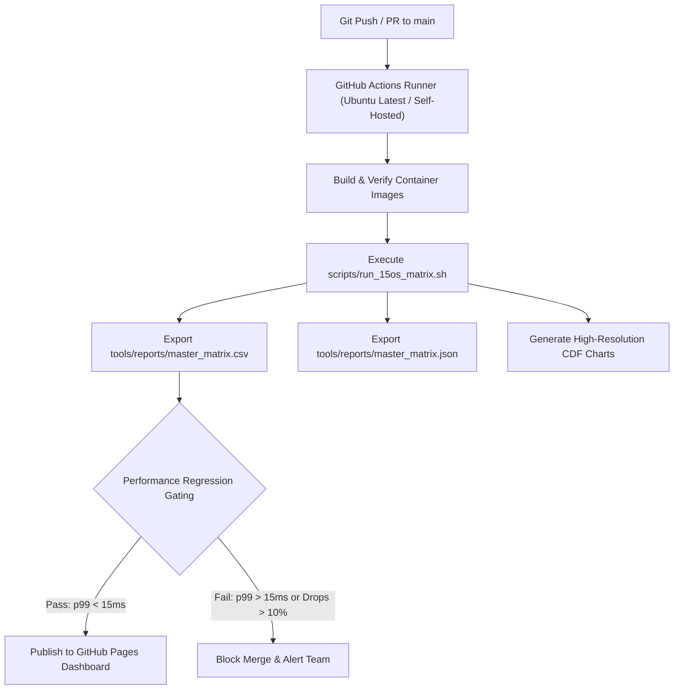

# Runbook: CI/CD Benchmarking Pipeline & Telemetry Automation
### *Continuous Benchmarking, GitHub Actions Workflows, and Performance Regression Gating*

---

## 1. Overview & Automation Architecture

To guarantee that code commits, kernel updates, and library upgrades never introduce hidden latency regressions or memory bloat, FerroOS maintains an automated Continuous Benchmarking Pipeline within GitHub Actions.



---

## 2. GitHub Actions Workflow Specification

The benchmark pipeline is defined under `.github/workflows/benchmarks.yml`:

```yaml
name: FerroOS 15-OS Master Benchmarks

on:
  schedule:
    - cron: '0 2 * * *' # Nightly at 02:00 UTC
  workflow_dispatch:
  push:
    branches:
      - main
    paths:
      - 'crates/**'
      - 'tools/**'
      - 'Dockerfile.server'

jobs:
  matrix-evaluation:
    name: 15-OS Devastating Matrix
    runs-on: ubuntu-latest
    timeout-minutes: 60

    steps:
      - name: Checkout Codebase
        uses: actions/checkout@v4

      - name: Set up Python 3.12
        uses: actions/setup-python@v5
        with:
          python-version: '3.12'

      - name: Install Benchmark Dependencies
        run: |
          python -m pip install --upgrade pip
          pip install matplotlib numpy

      - name: Execute 15-OS Devastating Matrix
        run: |
          chmod +x scripts/run_15os_matrix.sh
          ./scripts/run_15os_matrix.sh --memory 4g --cpus 2 --outdir tools/reports

      - name: Evaluate Performance Regression Gates
        run: |
          python3 -c "
          import json, sys
          with open('tools/reports/master_matrix.json') as f:
              data = json.load(f)
          ferro = next(item for item in data['targets'] if item['id'] == 'ferro-v2')
          if ferro['p99_ms'] > 15.0:
              print(f'❌ Performance Regression: p99 exceeded 15ms ({ferro[\"p99_ms\"]}ms)')
              sys.exit(1)
          if ferro['http_rps'] < 35000.0:
              print(f'❌ Throughput Regression: RPS dropped below 35,000 ({ferro[\"http_rps\"]} req/s)')
              sys.exit(1)
          print('✅ All Performance Gates Passed cleanly!')
          "

      - name: Upload Telemetry & Visual Artifacts
        uses: actions/upload-artifact@v4
        with:
          name: master-benchmark-telemetry
          path: |
            tools/reports/master_matrix.csv
            tools/reports/master_matrix.json
            docs/reports/*.svg
            docs/reports/*.png

      - name: Deploy Live Interactive Dashboard
        if: github.ref == 'refs/heads/main'
        uses: peaceiris/actions-gh-pages@v3
        with:
          github_token: ${{ secrets.GITHUB_TOKEN }}
          publish_dir: ./docs
          keep_files: true
```

---

## 3. Performance Regression Gating Criteria

Every PR touching low-level userland runtimes (`ferro-core`, `libferro_io.c`, memory allocators, or SQLite) must satisfy strict mathematical thresholds before merge approval:

| Metric Gate | Failure Ceiling | FerroOS Baseline | Enforcement Action |
| :--- | :---: | :---: | :--- |
| **HTTP Edge Throughput** | $< 35,000\text{ req/s}$ | **39,645.4 req/s** | Block Merge; trigger flamegraph profile |
| **Tail Latency ($p_{99}$)** | $> 15.0\text{ ms}$ | **10.47 ms** | Block Merge; alert systems team |
| **DNS Cache QPS (16k workers)**| $< 75,000\text{ QPS}$ | **88,461.8 QPS** | Flag PR for review |
| **Allocator Contention Ops**| $< 4,000\text{ ops/s}$ | **4,436 ops/s** | Flag PR for review |
| **Devastation Chaos Score** | $< 100.0\%$ | **100.0% (10/10)** | Critical failure; reject commit |

---

## 4. Local Pre-Commit Simulation

Engineers can replicate the exact GitHub Actions runner environment locally before pushing:

```bash
# 1. Run full 15-OS matrix with standardized 4GB/2CPU cgroups
./scripts/run_15os_matrix.sh

# 2. Verify all output artifacts are refreshed
git status -s tools/reports/ docs/reports/

# 3. Inspect generated SVG and PNG plots
open docs/reports/throughput_comparison.svg
open docs/reports/latency_percentiles_cdf.png
```
